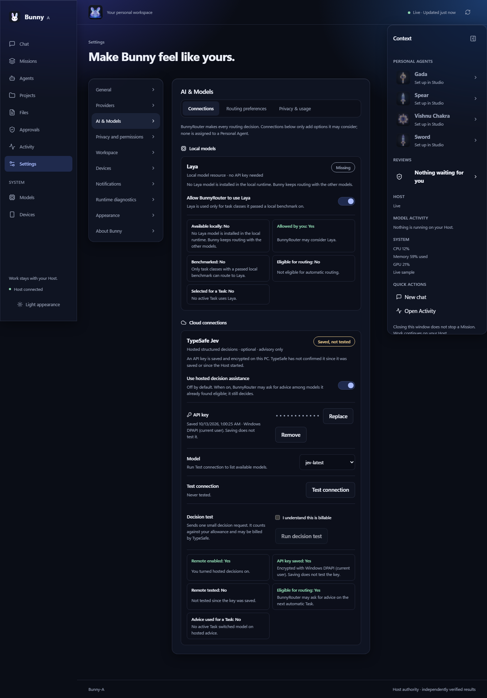
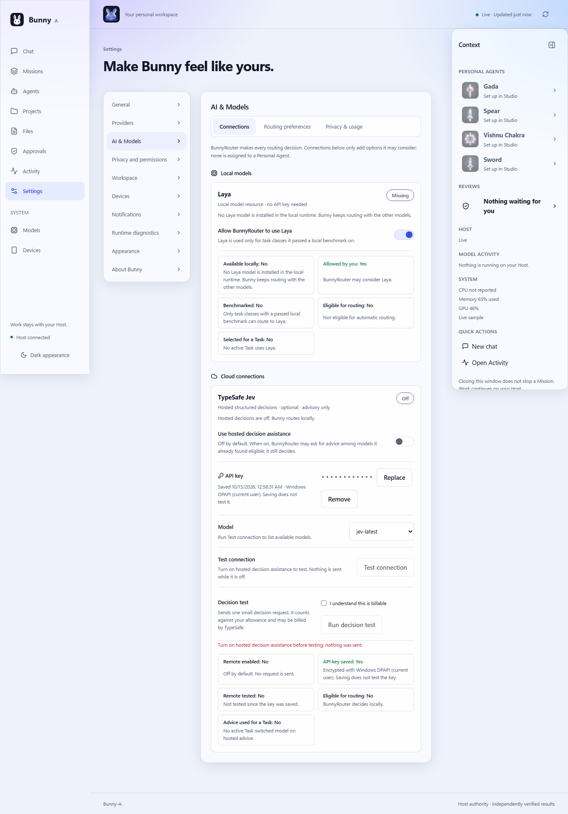

# MA3 T13.1 — Laya intelligence integration and optional TypeSafe Jev API: acceptance

**Verdict: BUNNY_MA3_T13_1_PASS_WITH_LIMITATIONS.**

Laya is integrated as a local model resource that BunnyRouter may use only for task classes it has passed a local
benchmark on. TypeSafe Jev is integrated as an optional, owner-only, advisory decision service behind a small audited
HTTP adapter. BunnyRouter remains the only router. Everything is off or zero by default, and Bunny A needs no API key.

The complete regression at the final source passes: **2,322 distinct cases, 0 failures**. All **2,264** T13 baseline
cases are retained exactly, and there are 58 new cases. TypeScript, lint and build pass. The exact Windows test package
verifies, has a closed import graph and matches its source commit. A disposable Host started from that package passes
12 of 12 live checks.

The limitations are real and stated plainly:

- No Laya model is installed on this PC, so Laya inference is **NOT TESTED**.
- No TypeSafe key was provided, so hosted Jev is **NOT TESTED** live and no request was ever sent to TypeSafe.
- The installed production release is not the one the brief names (see "Production preservation").

Evidence categories used throughout: **LIVE VERIFIED** (real local OS facility, runtime or HTTP surface), **SIMULATED**
(injected protocol or fault, no network), **STATIC VERIFIED** (code or document inspection), **NOT TESTED**.

## 1. Provenance

| Item | Value |
| --- | --- |
| Latest T13 evidence commit (recovered from local history) | `426357ac82240250f80b895c6350efe9ab7c0e9a` |
| T13 executable source | `8145377880fa4ab330238db827fa488430b2328d` |
| T13.1 implementation commits | `c8c46c914b53d5693927ba3361a2aa7b36828519` (integration), `aa134f5efb6748f21ec9a5fe4eae83f4c2d8d86f` (review fixes) |
| **Final source pin** (regression, evaluation, package, screenshots) | **`aa134f5efb6748f21ec9a5fe4eae83f4c2d8d86f`** |
| Branch | `claude/ma3-t9-phone-remote` (local only; nothing pushed) |

`test-results/ma3/t13-1/source-provenance.json` lists the 21 files changed since T13, and records that the first
complete regression at `c8c46c9` was superseded. The user's LOKAM logger work is not in either commit: the `.claude/`
hooks, `docs/lokam/`, `tests/test_lokam_evidence.py`, the `.gitignore` logger rules and the `test:session-evidence`
line in `package.json` all remain untracked or unstaged.

## 2. Architecture

BunnyRouter still makes every routing decision: classification, the eligible set, approval and launch. T13.1 adds two
optional inputs. There is no new orchestrator, no Jev-controlled scheduler, and no fixed assignment of Laya or Jev to
any Personal Agent.

- **Laya.** Laya-named models found by the existing model-capability registry are additional local candidates. The
  router's Laya gate excludes a Laya model for a task class unless that model passed a local benchmark covering the
  class, and that benchmark measured the build currently installed.
- **TypeSafe Jev.** This applies only to a direct, automatically routed Task submitted from the Windows workstation.
  If hosted decisions are on, a key is saved and the budget allows it, the Host sends routing metadata about the
  router's eligible set to `POST /v1/systemone`. It sends nothing for paired phones, manual model choices,
  Mission-delegated (internal Agent) Tasks or voice.
  - The answer is validated and then applied by `applyDecisionAdvice`, which can only pick inside the eligible set.
    It rejects any move that widens locality (local to hosted) or tools (tool-free to tool-capable). It also rejects
    advice from a superseded policy generation or older than 30 s.
  - Advice below the confidence thresholds falls back to the router's choice.
  - Approval, constraints, execution scope, folder and verification are never touched.
- **Local Decision Policy.** This is the documented fallback label for BunnyRouter's deterministic choice whenever
  there is no usable hosted advice. It is never labelled "Jev".

## 3. Laya

**Discovery: LIVE VERIFIED.** Laya is discovered through the existing capability registry; no parallel discovery was
added. On this PC, Ollama on `127.0.0.1:11434` lists `deepseek-v4.1-flash:cloud`, `huihui_ai/qwen2.5-abliterate:7b`,
`huihui_ai/qwen3-abliterated:30b`, `huihui_ai/Qwen3.8-abliterated:27b` and `qwen2.5-coder:7b`. None is a Laya model.

Settings, the package acceptance (check P03) and the evaluation therefore all report Laya as **Missing**:
"No Laya model is installed in the local runtime. Bunny keeps routing with the other models." Nothing is fabricated,
and Laya has no API-key field.

**Capabilities.** Only demonstrated facts are registered.

- The context window comes from the runtime's own probe. Tool calling, vision and embedding count only when the
  runtime reports them.
- Memory is shown only as a measurement taken while the model was loaded during a benchmark, and only alongside
  benchmarks of the current build.
- An offline runtime reads **Offline**, not Missing (R01).

**Benchmark before routing.** The benchmark is user-initiated and runs locally only. It has two checks per task class
(general, math, extraction, reasoning), and a class passes only if every check matches.

- Each result is bound to the model digest the runtime reports. When the same tag is re-pulled as a different build,
  its results stop counting at the next provider refresh (30 s loop), and the model becomes ineligible again (R04b).
- A runtime that reports no digest cannot be benchmarked.
- Covered routing classes come from a fixed mapping. Research, coding and repository coding are never unlocked by
  these checks (R03).

**Pipeline exercised live against a stand-in: LIVE VERIFIED (pipeline only, not Laya).** The checks ran against
`qwen2.5-coder:7b` (runtime digest `dae161e2…f4364`):

- general, extraction and reasoning passed 2 of 2;
- math failed 0 of 2 (answers "54" and "9" instead of 60 and 7).

The failure is the model's real answer, so the matcher behaved correctly. **Laya inference itself: NOT TESTED.**

## 4. TypeSafe Jev contract

The public documentation was re-read on 2026-10-12 (`test-results/ma3/t13-1/audit/typesafe-contract.md`, STATIC
VERIFIED):

- Base: `https://api.typesafe.ai`. Endpoints: `GET /v1/models` (account-scoped list, non-billable) and
  `POST /v1/systemone` with `{state, model, questions}`. Questions are of type `choice`, `score` or `noul`.
- Auth: `Authorization: Bearer <key>`.
- Errors: 401, 422, 429 (with `retry-after`) and 529.
- Models: `jev-latest` and `jev-preview` both resolve to `jev-1.13.0`.
- Price: $0.042 per million input tokens; output is free. Input is text only; context is 64k tokens.

No chat-completions or streaming endpoint was invented, and no SDK was installed. This is TypeSafe (api.typesafe.ai),
not any other "Jev-compatible" provider. The repository's legacy `releases/installed/JEV-Windows-v1` folder is an old
Bunny release name and is unrelated.

**Live compatibility: NOT TESTED.** No authorized key was provided. None was obtained, no account was created, and no
hosted call was made or claimed.

## 5. Credential design

| Requirement | Implementation | Evidence |
| --- | --- | --- |
| Encrypted at rest | Windows DPAPI, current-user scope plus entropy, run by `%SystemRoot%` `powershell.exe` over stdin | K03 LIVE, package P05 LIVE |
| Never plaintext in SQLite, settings JSON, Git, browser storage, Agent memory, telemetry, screenshots, errors or phone responses | Only ciphertext in `jev_credentials`. Snapshots carry `hasCredential` and the protection name only. The key is registered as a diagnostic secret and redacted | K03, K04, K15, K16, package P07/P11, `shots-*.json` |
| Owner-only authority | Every `intelligence.*` action requires the workstation token. A paired phone gets `WORKSTATION_REQUIRED` and a projection without the `intelligence` block | K05/K06, K07 STATIC, package P07/P08 LIVE |
| Save means saved, not tested | After Save the state is **Saved, not tested**. Only a successful explicit Test connection reads **Connected**, and a restart never restores it | K16, K17, screenshots |
| Replace, remove, temporary reveal | Masked key, Replace/Remove, and a password field with Show (`aria-pressed`) that auto-hides after 20 s. Save clears the field | K09, K10, `key-form-probe.json` |
| No background or automatic calls | Calls happen only on an explicit Test connection, an explicitly confirmed billable decision test, or an eligible owner Task while on and within budget | K02, K20, RV-B1, RV-S2, package P12 |

## 6. Settings → AI & Models

The page has three keyboard-navigable tabs (roving focus and arrow keys, `aria-selected`, labelled tab panels).

- **Connections.** Local models: the Laya card. Cloud connections: the TypeSafe Jev card.
- **Routing preferences.** Decision thresholds and the Local Decision Policy explanation.
- **Privacy & usage.** Metadata and request-text sharing switches, limits and the usage line.

The six facts are always shown separately: locally available, enabled by you or remote enabled, credential saved,
remote tested, eligible for routing, and selected for a Task. "Selected" counts only Tasks whose model actually
changed on hosted advice. Test connection and the decision test are disabled while hosted decisions are off.

Renders at final source: `shots-fresh.json` (6), `shots-saved.json` (12) and `shots-package.json` (12). All have no
horizontal overflow, no console errors, labelled tab panels, working arrow-key navigation, and no key material in the
DOM or browser storage. They cover desktop 1366×900 and phone 390×844, in light and dark themes.

## 7. Connection states

All ten states exist, each with a label and detail text, and only `CONNECTED` reads as healthy:

| State | Meaning |
| --- | --- |
| `DISABLED` | Hosted decisions are off (the default). |
| `NO_CREDENTIAL` | Hosted decisions are on, but no key is saved. |
| `SAVED_NOT_VERIFIED` | A key is saved but has not been tested since it was saved or since a restart. |
| `CONNECTING` | A test is in progress. |
| `CONNECTED` | An explicit test succeeded. |
| `AUTH_FAILED` | A 401 or 403. Persisted until the key is replaced. |
| `RATE_LIMITED` | A 429 or the cooldown. |
| `BUDGET_EXHAUSTED` | A ceiling was reached, including the default zero allowance. |
| `NETWORK_UNAVAILABLE` | A timeout or the endpoint is unreachable. |
| `PROVIDER_ERROR` | A 5xx/529 response, an invalid body, a redirect or an oversize response. |

## 8. Robustness and budgets

- **Transport.**
  - Allowlisted origin only (https, exact host, no port, user info or path).
  - Redirects refused with `redirect: "manual"`, so the key is never forwarded.
  - Refuses to send if TLS verification is disabled in the process.
  - Configurable timeout (default 8 s, clamped to 1–30 s) covering key retrieval and the whole call.
  - Responses are stream-read with a 256 KiB cap.
  - Strict schema validation of requests and responses; unknown fields are dropped.
- **Retries.**
  - Model discovery retries at most once on 429/529/5xx.
  - A billable decision is never retried.
  - Anything that may have reached TypeSafe without a known outcome is recorded as **unknown usage**, not as free.
- **Budgets.**
  - Defaults: 0 requests per session and per day.
  - Optional limits: daily tokens, a daily monetary cap and concurrency (1–4).
  - A strict budget (the default) fails closed when usage or price is unknown.
  - Each request is reserved in `jev_usage` before it is sent, in the same synchronous step as the budget gate, so
    concurrent requests cannot overshoot.
  - A row still pending at restart stays counted as `unknown_restart`.
- **Circuit breaker.** Three consecutive provider failures trigger a 5-minute cooldown. `retry-after` sets the cooldown
  for a 429. A refused key blocks further calls until it is replaced. Failure count, cooldown and the refused-key block
  are persisted, so a restart is not a free retry.
- **Cancellation.**
  - The owner's submit aborts the advice request if the client disconnects.
  - A cancellation before sending is free and changes no state.
  - A cancellation after sending is recorded as unknown usage but does not trip the breaker.
- **Thresholds and question library.**
  - Thresholds are configurable: accept ≥ 0.75, fall back below 0.5, clarify at an ambiguity of 0.8.
  - Questions are bounded: one `choice` over the eligible keys, one `score` and one `noul`.
- **Egress.** The default state has five metadata fields: task class, eligible model keys, depth-derived budget class,
  latency preference and the fixed category list. Request text is sent only if the owner opts in, capped at 2,000
  characters, and refused whole if it matches any credential pattern. Project content, files, transcripts, source,
  Agent scratch and audio are never sent. Agents cannot change the sharing policy (R10, R16, RV-B4).

## 9. Evaluation (`test-results/ma3/t13-1/eval/`, at the final source)

The labelled set has 32 author-labelled prompts across 8 task classes. Accuracy measures agreement with those labels
only.

| System | Category | Accuracy | P50 | P95 | Calibration |
| --- | --- | --- | --- | --- | --- |
| BunnyRouter (deterministic) | LIVE VERIFIED (code) | 68.8% (22/32) | 0.005 ms | 0.385 ms | n/a (no probabilities) |
| Local model `qwen2.5-coder:7b` as classifier | LIVE VERIFIED | 78.1% (25/32) | 341 ms | 461 ms | n/a |
| Laya | NOT TESTED | — | — | — | — |
| TypeSafe Jev, router + hosted advice | NOT TESTED live | — | — | — | — |

Advice-guard safety was run SIMULATED over 5,000 injected recommendations. These included out-of-set keys, injection
strings, random confidence, and stale generations and ages.

- False eligibility: **0**.
- Routes widened to hosted or tool-capable: **0**.
- Fallback to the router's choice: 94.7%.
- Validation cost: 1.83 µs per decision.

Calibration code (expected calibration error) is unit-tested (R17). It has no live Jev data to measure.

## 10. Tests

All tests listed here pass in the complete regression.

- `src/lib/bunny-host/intelligence.test.ts`:
  - **K01–K20** (API keys);
  - **R01–R20** (routing and security), plus R04b and R13b;
  - nine review tests, RV-B1 to RV-S7.
- `src/lib/bunny-host/intelligence-host.test.ts`: real Host HTTP — K04/K20, K05/K06, R07/R16 and RV-S2.
- `src/components/island/intelligence-model.test.ts`: 4 UI view-model tests.

Categories: K03 has a SIMULATED and a LIVE (DPAPI) variant. K07, R15 and R13b are STATIC VERIFIED. All others are
SIMULATED, using an in-process TypeSafe transport that records every request; nothing reaches the network.

Personal Agents: the four agents (Gada, Spear, Vishnu Chakra, Sword) keep their identity regardless of routing (R13).
Personal Agent code never names Laya, TypeSafe or Jev (R13b).

T12 voice: the voice modules never reach TypeSafe, and voice cancellation is independent of hosted decisions (R15).
No PCM or audio is ever sent. Advice has exactly one entry point, the owner's direct submit.

## 11. Independent review: findings and fixes

An independent review of `c8c46c9` found four blocking and nine significant issues. All are fixed in `aa134f5` or
documented below.

| Finding | Fix | Test |
| --- | --- | --- |
| B1 Test connection could call TypeSafe while hosted decisions were off | Refused locally: "Turn on hosted decision assistance before testing; nothing was sent." | RV-B1, package P06 |
| B2 Concurrent requests could overshoot request ceilings | Usage reserved before sending, synchronously with the gate | RV-B2 |
| B3 A request in flight at a crash was forgotten | A pending row survives restart as unknown usage, so strict ceilings fail closed | RV-B3 |
| B4 The secret filter was too narrow | `looksSecret`: PEM, provider keys, Bearer tokens, key/password assignments, AWS, GitHub, GitLab, Slack, Google, Stripe, JWT and credentialed URLs; text is refused whole | RV-B4 |
| S1 A chunked oversize body would be buffered | Stream read with a 256 KiB cap; the reader is cancelled | RV-S1 |
| S2 A paired phone's submit could spend the owner's allowance | Advice requested only for workstation submits | RV-S2 (Host HTTP) |
| S3 A dropped request kept running and counted as a provider failure | Aborted on client close; cancellation does not trip the breaker | RV-S3 |
| S5 Reroute and records ignored an adopted switch | `assistance.adopted` recorded; reroute and `routing.selected` use the launched candidate; UI counts only real switches | R18 |
| S6 Breaker, cooldown and refused key were lost on restart | Persisted guard | RV-S6 |
| S7 The billable decision test skipped guards | Same budget, refused-key and concurrency guards, checked before and after discovery | RV-S7 |
| S9 Laya benchmarks were not tied to a build, with one check per class | Digest-bound results; two checks per class, all required | R04, R04b |
| F04 regression: `powershell.exe` launched by bare name | Absolute path through `systemTool` | `provider-containment` F04 |

Two findings are documented rather than code-changed:

- **S4.** `GET /v1/models` is documented as account-scoped, which implies it needs a valid key, but whether a bad key
  is refused there is unverified. Test connection therefore never claims inference; only the explicit decision test
  does. Live verification is NOT TESTED.
- **S8.** Pre-existing: the workstation token file is readable by other processes running as the same Windows user.
  That is the existing Host trust boundary, unchanged by T13.1, and recorded as a limitation.

## 12. Complete regression (`test-results/ma3/t13-1/regression-final/`)

The run used a clean detached worktree of `aa134f5`, verified by `run-regression.mjs` to be at that commit with
"clean tracked tree at start". Ignored local inputs were staged in from the main checkout and never committed:
`node_modules` (as a junction), the pin-checked whisper runtime, the native helper and the runtime licence.

| Part | T13 baseline | T13.1 | Result |
| --- | --- | --- | --- |
| scripts | 440 | 440 | PASS |
| library | 1,408 | 1,462 | PASS |
| agent | 58 | 58 | PASS |
| UI | 358 | 362 | PASS |
| **Total distinct** | **2,264** | **2,322** | **0 fail / 0 skip / 0 cancelled** |

The baseline mapping is one-to-one: **2,264 of 2,264** baseline cases are retained exactly, with 0 revised and 0
missing (`baseline-retention-map.json` is empty). There are 58 new cases: 54 library and 4 UI. Each case is counted
once; focused development reruns are in `dev-runs/` and labelled NOT COUNTED.

The gates also pass: pretest, `npm run typecheck`, and `npm run lint` with 0 errors and the same 27 warnings as the
T13 baseline. `npm run build` passes, with all three environments built.

The superseded complete run at `c8c46c9` (library 1,450/1,451, F04 failing) is kept in
`regression-superseded-c8c46c9/` and labelled NOT COUNTED. An earlier archive-checkout attempt is kept the same way.

## 13. Windows test package and disposable Host acceptance

- Package: `Bunny-A-Windows-MA3-T13-1-TEST`, version `0.0.0-ma3-t13.1.1`, source and tooling `aa134f5`.
- Archive: 179,661,566 bytes, SHA-256 `04e5f27f43c985f3a77dba37a47d123d0333a1166b23da77cb2a460f00b1c96f`.
- Verification: **482** files checked with none extra, missing or changed. The import closure has **126** files with
  none missing or outside; `playwright` is optional. The source check matched **172** files against the commit's blobs
  with none mismatched. See `package-results.json` and `package-release-manifest.json`.
- The package was not installed or published.

**Disposable Host acceptance: LIVE VERIFIED, 12/12** (`package-acceptance.json`). The Host was started by the
package's own `node.exe` from the packaged source, on port 43892 with disposable temp state. The package's built
dashboard was rendered on `127.0.0.1:8081`. The checks:

- **P01** The packaged runtime ran the packaged source.
- **P02** BunnyRouter is the router and "Local Decision Policy" the fallback.
- **P03** Laya is truthfully Missing.
- **P04** Jev defaults are off with a 0/0 allowance.
- **P05** Save works with real DPAPI and leaves the state at DISABLED.
- **P06** Test connection is refused locally while off.
- **P07** The phone projection carries no intelligence block.
- **P08** The phone is default-denied all four credential and configure actions.
- **P09** 12 clean package renders.
- **P10** The owner can remove the key.
- **P11** The key is absent from state files and process output.
- **P12** There are **0** `jev_usage` rows: no TypeSafe request was reserved or sent.

The development state layout was used. The installed layout requires a migrated production state, which was
deliberately not created.

## 14. Production preservation

The production check was a read-only observation before and after (`production/production-comparison.json`). The
installed release, `install.json`, the release manifest (478 files), the listeners on 43119 (PID 13924) and 8084 (PID
19896), their processes, the Startup shortcut and the audio settings are all **unchanged**. Only the running Host's own
`events` and `providers` rows changed, which is its normal activity; T13.1 opened the database read-only.

No install, restart, migration, Startup change, tunnel activation, credential change or GitHub push was performed.

**Discrepancy with the brief.** The brief says the installed production version remains `Bunny-A-Windows-v26-MA2-R1`.
The live install record names **`Bunny-A-Windows-MA3-T13-FINAL-TEST`**, installed at 2026-10-12T23:28:45Z from
`8145377`. That install predates this T13.1 session, which began 2026-10-13T03:28Z, and no installer, launcher or
migration command was run in it. T13's own final observation (22:50Z) still showed MA2-R1, so the change happened
between T13 closeout and the start of T13.1. T13.1 left production exactly as found and did not attempt to revert it.

## 15. Limitations

1. **Laya inference NOT TESTED.** No Laya model is installed. Discovery, the Missing state, eligibility gating and the
   benchmark pipeline are verified; Laya's own quality and latency are not.
2. **TypeSafe Jev live NOT TESTED.** There was no authorized key. The contract is STATIC VERIFIED and behaviour is
   SIMULATED, including 401/403/422/429/529, timeouts, redirects, oversize bodies, malformed answers, budgets and
   restarts. Real decision accuracy, latency and calibration are unknown. Whether `/v1/models` refuses an invalid key
   is unverified (S4).
3. **Same-user token exposure (S8).** This is pre-existing and outside T13.1's scope.
4. **The labelled evaluation set is author-labelled.** It measures agreement with those labels, not general accuracy.
5. **Package acceptance used the development state layout.** The installed layout was deliberately not exercised.
6. **Installed production is T13-FINAL-TEST, not MA2-R1** (section 14). This needs the owner's attention; it was not
   changed here.
7. **Cross-vendor hosted switches are allowed.** Accepted advice may move a hosted Task to a different hosted provider
   that BunnyRouter already found eligible (for example Claude to Codex), when it adds no tools. Locality and tools
   are never widened, but the Task then goes to a different third party. A same-vendor rule was not added after the
   final regression; it is a candidate follow-up.
8. **No retention policy for `jev_usage`.** Rows are indexed by time and only the current day is counted, but old
   rows are never pruned.

## 16. Evidence

Evidence is in `test-results/ma3/t13-1/`, indexed in `INDEX.md` and byte-sealed in `INDEX.sha256`. Verify it with
`node test-results/ma3/t13-1/seal-evidence.mjs --verify`.

`secret-scan.mjs` scanned the evidence and this report. Only labelled `FIXTURE` keys appear; there are no real keys,
DPAPI blobs, workstation tokens or raw private content.

Package folders and archives are excluded from the seal and pinned by `package-results.json`. The evidence commit is
separate from the implementation commits. Nothing was pushed. T14 was not started.
