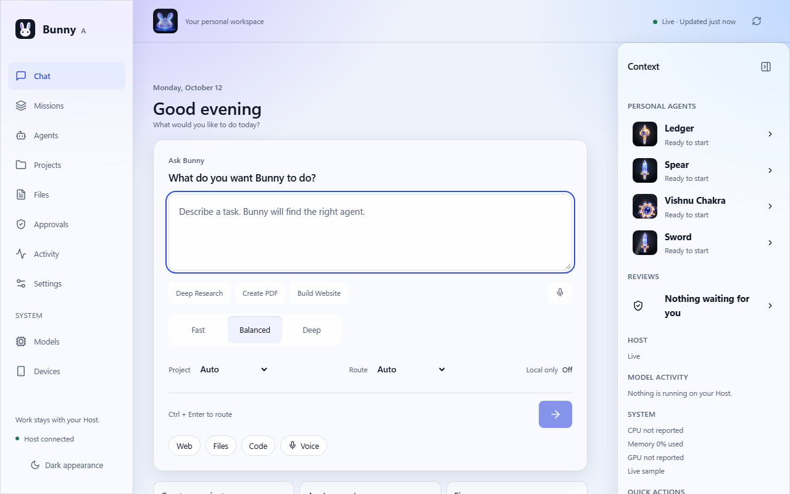
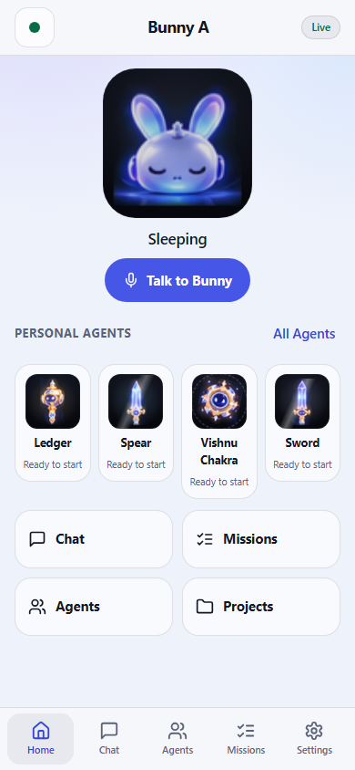

# Bunny A — MA3 T13 UI/UX mastery acceptance

**BUNNY_MA3_T13_PASS_WITH_LIMITATIONS.** The companion-led glass workspace, four configurable Personal Agents, native four-edge Notch and phone companion are implemented. Final regression has **2,264 distinct PASS / 0 FAIL / 0 SKIP**, all build gates pass, and the exact Windows test package renders like development on desktop and mobile. Final visual acceptance is provisional; specified hardware and human-interaction coverage remains untested. This is a development/test acceptance, not production promotion or T14 release approval.

## Source and scope

| Item | Pin |
| --- | --- |
| Accepted T12 executable source | `86cc164d103edb97b7c39de0f520bc37d40e1db4` |
| Recovered exact T12 evidence ancestor | `f104057d125d3265587d55d20fcf2eb555489303` |
| T13 implementation commit | `5152e937eae57895eaf8dd55ad44f99c6f44911d` |
| Final T13 executable/tooling source | `8145377880fa4ab330238db827fa488430b2328d` |
| Branch | `claude/ma3-t9-phone-remote` |
| Evidence commit | Separate local descendant returned in the completion message; includes this report and `test-results/ma3/t13/INDEX.sha256`. |

T12 ancestry was verified. The final regression ran in a clean detached checkout of the final source, using the existing Node dependencies, pin-verified speech runtime and local runtime license. The user's separate LOKAM logger work remains outside the T13 source/evidence commits; its package script and ignore changes were preserved in the working tree. No GitHub push, deployment, installation, production restart, database migration, tunnel activation, Startup or credential change occurred. T14 has not begun.

## Artwork and design

Original: `assets/t13/source/bunny-a-showcase-original.png`, 1536×1024, SHA-256 `e390442a70b8c6620f37d9b59b48260e864e051b838185bac5ef70cb631fc7fd`. The original is preserved separately from derivatives. `assets/t13/derive_assets.py` and `assets/t13/derived/manifest.json` document crop/matte provenance; runtime PNGs are in `public/bunny-a/characters` and shipped in the package. No character was generated as a substitute. The local share card uses that supplied art; nothing was published.

Selected Bunny: the board's **Companion States** character — glossy white helmet, lilac-blue ears, black visor, arc eyes and headphones. The board's hero is used at larger sizes; its eight expressions drive the nearest canonical companion state with rings/badges where the board has no dedicated expression. Selection and relationship to the source are documented in [the design specification](docs/t13/BUNNY_A_T13_DESIGN_SPEC.md).

| Personal Agent | Identity and implemented motion |
| --- | --- |
| Gada | Supplied gold/blue mace silhouette, weighted float/tilt and orb-centered effects. |
| Spear | Supplied crystalline spear, precise vertical float and directed light/scan effects. |
| Vishnu Chakra | Supplied circular weapon, continuous orbital motion and radial effects. |
| Sword | Supplied blade/hilt, balanced hover/tilt and directional sheen/trace effects. |

The web character engine implements the full state/effect matrix in the specification: idle, planning, research, coding, testing, files, verification, waiting, permission, pause, completion, failure, stop, recovery, unknown and offline. Native compact characters use bounded float/rotation, state timing, rings, badges and acknowledgments; they do not reproduce every web effect layer. Their identity never changes with a provider choice. Names, purpose, descriptions, interaction style, responsibilities, binding and visibility are presentation preferences; execution permissions remain canonical Host authority. No scheduling or automatic authority renewal was invented.

Motion uses transforms of the supplied stills/pose tiles and supplementary effect layers. Higgsfield loops requested in the original session were unavailable because of account credits; still motion is the delivered fallback. No 60 FPS guarantee is made.

## Implemented surfaces and interactions

The desktop defaults to Chat, with Missions, Agents/Studio, Projects, Files, Approvals, Activity and Settings; Models/Devices form a separate System group. A collapsible right panel shows actual Personal Agents, reviews, Host state, model work and available telemetry. Light/dark glass tokens, opaque accessibility fallbacks and reduced/off motion are shared. Chat and durable Missions stay separate; closing a view does not cancel admitted background work.

Studio exposes exactly four unique weapon slots. Saves use workstation-only `personal_agents.configure`, validate existing user-facing Agent bindings, and carry the reviewed revision. Dirty-draft conflicts preserve edits; Discard now adopts the newest revision. Existing old bindings remain editable even outside the fifty newest candidates. Internal team members remain internal even when Mission evidence cannot load. Provider/model identities are technical resources, never weapon identities.

The phone has touch-first Home, Chat, Agents, Missions and Settings navigation, safe-area rules and explicit connection uncertainty. The landscape companion now occupies the full viewport instead of a desktop sidebar column. Device permissions still follow per-request Host policy; workstation-only approvals cannot become phone Allow actions. Voice is workstation-only; loopback screenshots are workstation context and are not physical-phone voice evidence.

## Docking and native evidence

| Edge | Form | Agent strip | Panel expansion |
| --- | --- | --- | --- |
| Top | Horizontal | Left | Down |
| Bottom | Horizontal | Left | Up |
| Left | Vertical | Above | Right |
| Right | Vertical | Above | Left |

`live-notch/live-dock-receipts.json` records **18/18 earlier-source LIVE Host/native checks**: four edges, order, safe work-area placement, drag offsets and relaunch persistence. Pointer release coordinates were synthetic; keyboard and fallback paths are identified in the receipt. Four-edge renders and source-board comparison sheets are retained in `notch/compare/` and `live-notch/shots/`.

The final source repairs make weapon chips actual WPF Buttons with standard automation peers, Name, Tab stop and Invoke pattern; Back/Escape returns focus. `native-peer-check.json` verifies the real product Button factory as a software unit. Native HAPPY now respects speech/permission/error/mute precedence; verification memory uses Agent identity, and rebind/first-load/offline reconnects do not celebrate unobserved work. Removed chips and hidden/minimized windows suppress their loops, and reduced motion freezes live level scaling. **Actual final-source Tab/Enter/Space/minimize interaction was not rerun**: the supported native tool did not expose the development overlay as a target. Earlier real docking is not represented as final keyboard acceptance.

## Real Host and voice integration

`live-agentic/final-live/results.json` records **40/40 LIVE checks** against disposable Host data, real filesystem operations and shell-free `node --test` execution. It demonstrates truthful completed/unverified versus verified outcomes, Testing from actual argv, explicit pending permission, pause as an admission hold, resume, denial without deletion, stop, verified artifacts, and Mission completion after the entire browser context closed. Reopened results seed without replaying celebration; observed verified/failed transitions trigger one cue. Earlier failed/premature attempts are retained and excluded from pass claims.

The presentation adapter uses canonical Agent/Mission/Task facts and fresh provider events. No elapsed-time percentages, model “done” claims or guessed coding states are used. Missing/stale/offline facts remain uncertain. Voice replies are ordered by process/revision and guarded against principal generation and Host identity changes; pairing tears down pending poll/press state. The render clock now evaluates newly received interruption receipts immediately instead of against the previous two-second tick.

Historical T13 real-worker voice evidence is retained. Timeline reanalysis corrects a cached-sampler false failure at +20 ms; the old web run still displayed Speaking for **626 ms after an externally issued Host cancellation receipt**. That polling/gateway lag is disclosed. The separate READY blip from the cached render clock was repaired. **Final-source human/acoustic cancellation and simultaneous capture/playback were not newly retested**; accepted T12 hardware evidence is not promoted into a universal or final-source reliability claim.

## Verification and regression

| Final source suite | Distinct passed |
| --- | ---: |
| Scripts | 440 |
| Library | 1,408 |
| Agent | 58 |
| UI | 358 |
| **Total** | **2,264** |

All **1,995 baseline cases are accounted for**: 1,991 retain their exact suite/name identity; four UI assertions were deliberately revised for the locked T13 contract (four weapons, new strip axes, no internal-worker letters). The one-to-one mapping and reasons are in `baseline-retention-map.json`. There are **269 additional distinct cases**, with zero missing baseline mappings. Focused tests, live demos and reruns are not added again to this total.

Final per-lane exits: pretest, scripts, library, Agent, UI, typecheck, lint and build all **0**. Lint reports 27 warnings and no errors. The first script lane lacked a local runtime license; it was rerun in full after copying the existing license. Archive setup failures and the first clean-run failure remain preserved. The final summary combines one successful log per independent suite from the same source pin rather than pretending the earlier overall runner exited successfully.

Final development and exact Windows-package smoke tests inspect 1280×800 and 390×844 renders with visible content, no horizontal overflow, no console/page errors, no brand/auth warnings and **no baseline divergence**. Both image pairs were visually inspected. The Windows package uses the same Node HTTP middleware adapter as its production gateway; generic Vercel preview cold-state diagnostics are retained separately.

Earlier desktop captures cover 1920×1080, 1366×768 and 1280×800, multiple surfaces and both themes. Earlier phone portrait captures cover 320/375/390/430 widths; final supported-browser Home/Settings interaction verifies the landscape repair. The old pairing and Host-changed workstation simulations did not reach their intended states and are **not** paired-device acceptance.

Representative final workspace:

Representative phone render (loopback workstation context):

## Accessibility, performance and security review

The separate source reviewer found and helped repair additional issues beyond the original session's review. The review explicitly distinguishes independent findings from author verification. Root cross-reviewed the repaired native paths and ran the WPF peer software check; source/test guards cover stale voice replies, identity-bound cues, internal-Agent separation, finite authority and remote restrictions. There is no unresolved known HIGH/BLOCKER in the final source review; **this is not an external independent release audit**. The original evidence audit and final closeout notes preserve failed runs and untested configurations.

Earlier headless active animation measurement was about **25–26 FPS**, versus **57.7 FPS** in a control with animation artificially paused. Earlier native CPU averaged **28.07% of one core collapsed**, **38.02% expanded**, **6.04% Motion Off**, and **18.59% minimized before the hidden-motion repair**. These are single-configuration historical measurements; final minimized cost, GPU FPS and battery behavior were not remeasured. Reduced motion is available, but low idle resource cost across hardware is not certified.

## Package and production preservation

Local package: `test-results/ma3/t13/windows-package-closeout/Bunny-A-Windows-MA3-T13-FINAL-TEST.zip`, version `0.0.0-ma3-t13.1`, source/tooling pin `8145377880fa4ab330238db827fa488430b2328d`. Exact archive byte size and SHA-256, release manifest and verification results are in `package-results.json`.

Package verification checks **477 listed files**, **167 exact source origins**, and a **121-file runtime import closure**, with no missing, changed or mismatched files. The dashboard and native ownership/voice binaries were built from the pin; staged speech inputs were hash checked. The package was not installed.

Installed production remains **Bunny-A-Windows-v26-MA2-R1**. Read-only comparison preserves install metadata, the 161-file release manifest hash, Host/gateway process identities and listeners, Startup shortcut presence and microphone-privacy values. The live database has ordinary background journal/provider-observation changes; invariant database bytes are not claimed. No task-specific production mutation was performed.

## Explicit limitations and evidence

- Final user visual approval is unrecorded; selection/rationale and inspectable renders are preserved as provisional.
- One display at 150% scaling was available; real multi-monitor, mixed DPI, alternate taskbar arrangements and monitor removal were not tested. Geometry simulations are labeled separately.
- Final physical native keyboard/screen-reader/hidden-window validation and final CPU/GPU/battery measurements remain untested after the repairs.
- Physical phone, iOS/Android safe-area behavior, LAN/internet transport, real device pairing/revocation/Host-change UX and phone voice remain untested.
- Final-source human acoustic voice trials were not rerun; historical web cancellation lag and accepted T12 hardware limits remain disclosed.
- Native compact effects are simpler than the full web matrix; paid generated motion loops were unavailable. Delegated script consent does not bind `node --test`; one-time approvals cannot broaden it, and the repeated-ask UX is a known limitation. The demonstrated reviewed-plan execution path works without loosening scope.

Evidence root: [test-results/ma3/t13/INDEX.md](test-results/ma3/t13/INDEX.md). SHA-256 seal: `INDEX.sha256`; verification utility: `seal-evidence.mjs --verify`. Detailed classifications and corrections: `CLOSEOUT_NOTES.md`. Design contracts: `docs/t13/BUNNY_A_T13_DESIGN_SPEC.md`. Source review: `docs/t13/T13_FINAL_INDEPENDENT_REVIEW.md`; preserved evidence audit: `docs/t13/T13_VERIFICATION_EVIDENCE_AUDIT.md`. Original and optimized art remain traceable. No credentials, private session logs or raw transcript artifacts are included in the retained commit.

BUNNY_MA3_T13_PASS_WITH_LIMITATIONS
