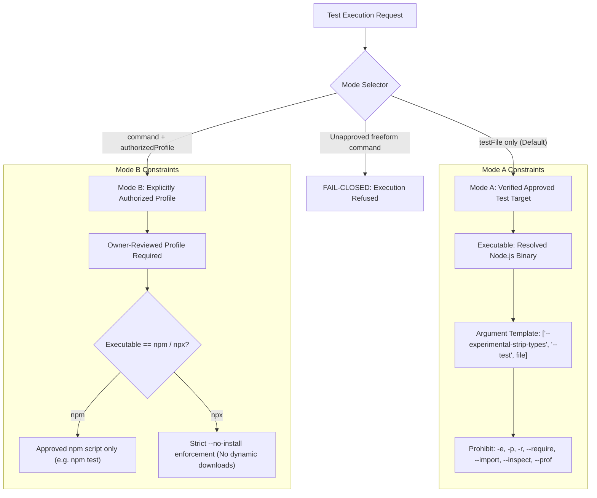

# MA4-S3-T3R2 — Executable & Argument Execution Policy

## 1. Problem Statement & Ambience Analysis

Allowlisting executable basenames such as `node`, `npm`, or `npx` with `spawn(..., { shell: false })` is insufficient to establish an execution boundary. Although disabling shell interpretation prevents command injection syntax (e.g., `;`, `&&`, `|`), those binaries themselves possess ambient capabilities to execute arbitrary unreviewed code, install packages, open debug listeners, and access the network:
- `node -e "..."` executes arbitrary inline JavaScript outside reviewed test files.
- `node --require ./payload.js` preloads arbitrary modules before executing any test.
- `node --inspect` opens a remote debugging socket allowing arbitrary code injection.
- `npx package-name` dynamically downloads and executes unpinned packages from npmjs.org.
- `npm run <unreviewed-script>` invokes arbitrary developer shell commands defined in `package.json`.

---

## 2. Two-Tier Execution Policy Architecture

MA4-S3-T3R2 formalizes a strict two-tier policy separating automated verification from owner-authorized execution:



---

## 3. Mode A: Verified Approved Test Target

Mode A is the default execution mode used by autonomous agents and Host verification pipelines.

### 3.1 Strict Argument Template
When a test file is executed under Mode A, the Host bypasses user/model-supplied arguments and applies a locked argument template:
```ts
const args = ["--experimental-strip-types", "--test", testFileRelative];
```
No additional flags, module preloads, or shell wrappers may be appended.

### 3.2 Prohibited Flag Matrix
If a caller supplies a Node.js command string, it is parsed into discrete tokens using `splitCommandLine` and inspected against the prohibited flag table:

| Prohibited Flag | Threat / Vulnerability Prevented | Enforcement |
| :--- | :--- | :---: |
| `-e`, `--eval` | Arbitrary inline script execution | Refused |
| `-p`, `--print` | Arbitrary inline script evaluation and print | Refused |
| `-r`, `--require` | Arbitrary module preloading before test execution | Refused |
| `--import` | ES module preloading before test execution | Refused |
| `--loader` | Custom module loader injection | Refused |
| `--inspect`, `--inspect-brk` | Remote debugging listener opening remote control port | Refused |
| `--prof` | Diagnostic profiling writing outside execution boundary | Refused |

Any occurrence of these flags causes immediate pre-spawn refusal with `terminalState: "refused"`, `exitCode: null`, and `receipt: null`.

---

## 4. Mode B: Owner-Authorized Project Test Profile

Mode B allows projects with custom build steps or testing tools to run under explicit human owner authorization.

### 4.1 Owner-Reviewed Profile Specification
Mode B requires an `authorizedProfile` registered in the task specification and reviewed by the workstation owner:
```ts
interface AuthorizedCommandProfile {
  profileId: string;
  executable: "node" | "npm" | "npx";
  allowedArguments: string[];
  projectScope: string;
  allowNetwork: boolean;
  timeoutMs: number;
}
```
No model or autonomous agent may synthesize or expand an approved command profile.

### 4.2 Lockdown of npm and npx
1. **Unapproved npm Scripts Refused:** Invoking `npm run <script>` without an authorized profile matching that exact script is refused:
   ```text
   Test launch refused: Direct execution of "npm" requires an owner-authorized Mode B project command profile.
   ```
2. **Prohibition of Dynamic Package Installation via npx:** `npx` must never fetch packages from the public internet during test execution. If `npx` is authorized in Mode B, it must include `--no-install` to ensure only local node_modules are executed:
   ```ts
   if (cmdBase === "npx" && !tokens.includes("--no-install")) {
     return makeRefusal(executionId, "Dynamic package installation via npx is strictly forbidden.");
   }
   ```

---

## 5. Executable Identity & PATH Security

1. **Host-Controlled Resolution:** PATH environment variable lookup is strictly bounded. The Host resolves the absolute path of the target executable (`process.execPath` for `node`) and validates that it points to a trusted local executable.
2. **Environment Sanitization:** Child process environment variables are sanitized (`cleanEnv`). Ambient credentials (`AWS_*`, `GITHUB_*`, `ANTHROPIC_*`, `OPENAI_*`) are stripped before launch.
3. **Identity Stability:** The resolved executable binary is hashed and bound to the test receipt to ensure the binary is not substituted between approval and execution.
