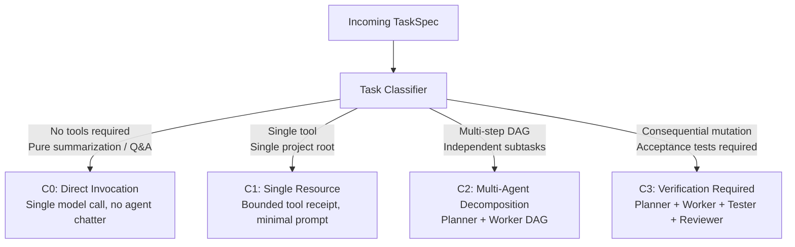

# MA4-S3-T4 Adaptive Task Planning Specification

**Product:** Bunny A by LOKAM  
**Milestone:** MA4-S3-T4  
**Module:** `src/lib/bunny-host/ma4/adaptive-planner.ts`  

---

## 1. Adaptive Complexity Classification (C0–C3)

Task planning in Bunny A adapts to task complexity, preventing the computational waste of multi-agent decomposition on straightforward queries while maintaining rigorous verification for high-risk mutations.

### 1.1 Classification Criteria

| Tier | Name | Target Workflows | Invoked Roles | Tool Overhead | Verification Gate |
| :--- | :--- | :--- | :--- | :--- | :--- |
| **C0** | Direct Model | Code explanation, summarization, syntax guidance, question answering | Direct Model | 0 tools | Host format check |
| **C1** | Single Resource | Read 1 file, check git status, parse single log, inspect port | Single Worker | 1 tool | Exit code & output hash |
| **C2** | Multi-Step DAG | Cross-file diffing, multi-step code generation, multi-file linting | Planner, Worker | 2–8 tools | Intermediate DAG receipts |
| **C3** | Verification Required | File writes, service calls, test execution, acceptance contracts | Planner, Worker, Tester, Reviewer | Full registered tools | Full test suite receipts + reviewer signoff |

---

## 2. Plan Graph Optimization Algorithms

The plan optimizer processes proposed plans through four deterministic transformations:

### 2.1 Redundant Step Elimination
When a model proposes duplicate operations (e.g. reading the same configuration file multiple times across different steps), `validateAndOptimizePlanGraph` computes a canonical signature for each step:
$$\text{Signature}(S_i) = \text{SHA256}(\text{kind} \parallel \text{canonicalJSON}(\text{input}))$$
If $\text{Signature}(S_j) == \text{Signature}(S_i)$ where $i < j$:
- Step $S_j$ is eliminated from the execution plan.
- Downstream steps depending on $S_j$ are automatically rewritten to depend on $S_i$.

### 2.2 Topological DAG Leveling
To maximize throughput without violating data dependencies:
1. Performs cycle detection via Kahn's algorithm. If a cycle is detected, the plan is rejected (`CYCLE_DETECTED`).
2. Assigns each step to an integer level:
   $$\text{Level}(S) = \begin{cases} 0 & \text{if } \text{dependsOn}(S) = \emptyset \\ 1 + \max_{D \in \text{dependsOn}(S)} \text{Level}(D) & \text{otherwise} \end{cases}$$
3. Steps in the same level execute concurrently (subject to resource scheduler bounds), while successive levels await prerequisite receipt completion.

### 2.3 Verified Artifact Reuse
Before executing a step, the planner checks `ma4_task_outcomes` for identical verified operations:
- Matches `kind`, `canonicalJSON(input)`, and source file content hash.
- If a verified receipt exists with `exitCode === 0` and is younger than the cache TTL:
  - The step is satisfied immediately from the verified artifact cache.
  - Zero model calls or tool invocations are dispatched, reducing latency and VRAM thrashing.

### 2.4 Stylistic Confirmation Prevention
- In prior iterations, Reviewer was frequently invoked merely to confirm trivial changes or output formatting.
- MA4-S3-T4 restricts Reviewer activation strictly to C3 tasks involving consequential side effects, security-sensitive capabilities, or explicit acceptance test verification.

---

## 3. Host Authority & Invariant Preservation

The Adaptive Planner is an **optimization proposer**, not an autonomous authority:
1. **No Self-Privilege Escalation:** An LLM cannot change its own task class from C1 to C3 to acquire permissions, nor can it grant itself unregistered tools or roots.
2. **Immutable Acceptance Contracts:** Acceptance criteria defined in `TaskSpec.acceptance` cannot be edited, skipped, or weakened by planner optimization.
3. **Fail-Closed Preflight:** If the optimized plan references a capability absent from the owner's authorization envelope, the task fails validation immediately before a single step executes.
