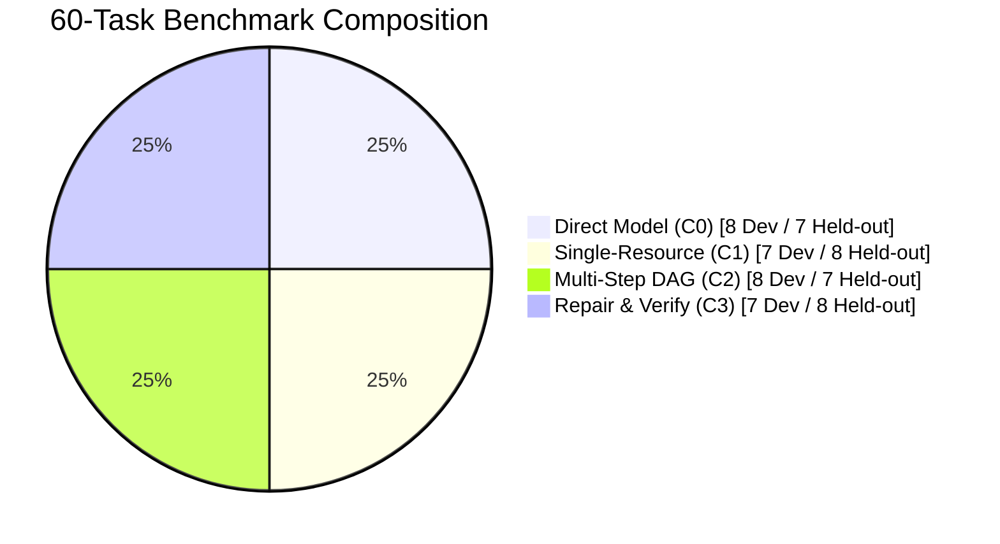

# MA4-S3-T4 Frozen Benchmark Dataset Specification

**Product:** Bunny A by LOKAM  
**Milestone:** MA4-S3-T4  
**Benchmark Module:** `src/lib/bunny-host/ma4/live-benchmark.server.ts`  
**Execution Script:** `scripts/run-live-benchmark.mjs`  
**Target Model:** `qwen2.5-coder:7b` (Ollama v0.40.11 local)  

---

## 1. Benchmark Overview & Design Goals

Prior milestones utilized small, synthetic, or mock suites. MA4-S3-T4 establishes a **frozen 60-task evaluation benchmark** executed against the live, un-mocked local `qwen2.5-coder:7b` model to evaluate:
1. **Task Completion Rate:** Baseline vs Candidate.
2. **Model Call Efficiency:** Model invocations per verified success.
3. **Execution Latency:** Time to verified completion.
4. **Tool Call Precision:** Unnecessary tool invocations avoided via adaptive C0-C3 planning.
5. **Memory A/B Generalization:** Performance difference with verified Lotus experience memory enabled vs disabled.

---

## 2. Dataset Partitioning

The benchmark dataset consists of exactly **60 tasks**, partitioned across 4 functional categories with balanced 30 development / 30 held-out splits:

| Category | Class | Total | Dev Split | Held-out Split | Description & Complexity |
| :--- | :--- | :--- | :--- | :--- | :--- |
| **Direct Assistant** | C0 | 15 | 8 | 7 | Pure conversation, code explanation, regex generation, algorithm design. Zero tool calls. |
| **Single-Resource Grounded** | C1 | 15 | 7 | 8 | File parsing, log inspection, config extraction, git status. 1 tool call required. |
| **Multi-Step Compositional** | C2 | 15 | 8 | 7 | Cross-file dependency analysis, schema diffing, multi-source synthesis. 2–4 tool DAG. |
| **Repair & Verification** | C3 | 15 | 7 | 8 | Bug fixing, broken loop remediation, test generation, acceptance verification. |
| **Total** | | **60** | **30** | **30** | Balanced 50% dev / 50% held-out partition |

---

## 3. Detailed Task Inventory

### 3.1 Category 1: Direct Assistant (C0) — 15 Tasks
- `DIR-01` (Dev): TypeScript Readonly Utility Type Syntax
- `DIR-02` (Dev): ISO 8601 UTC Timestamp Regex
- `DIR-03` (Dev): Fast Binary Search Index Logic
- `DIR-04` (Dev): Dockerfile Multi-Stage Best Practices
- `DIR-05` (Dev): HTTP 409 Conflict Semantic Explanation
- `DIR-06` (Dev): SQL Window Function Syntax
- `DIR-07` (Dev): SemVer Major vs Minor Criteria
- `DIR-08` (Dev): Async Generator Syntax
- `DIR-09` (Held-out): LRU Cache Time Complexity
- `DIR-10` (Held-out): CSS Flexbox vs Grid Rule of Thumb
- `DIR-11` (Held-out): JWT Signature Alg Definition
- `DIR-12` (Held-out): Git Rebase vs Merge Tradeoff
- `DIR-13` (Held-out): Exponential Backoff Formula
- `DIR-14` (Held-out): OAuth2 Authorization Code Grant Flow
- `DIR-15` (Held-out): Big-O of QuickSelect

### 3.2 Category 2: Single-Resource Grounded (C1) — 15 Tasks
- `GND-01` (Dev): Package Version Extraction (`package.json`)
- `GND-02` (Dev): Port Extraction from `.env`
- `GND-03` (Dev): Log Error Code Parsing (`server.log`)
- `GND-04` (Dev): Changelog Release Date Lookup (`CHANGELOG.md`)
- `GND-05` (Dev): Database Driver Setting (`db.config.json`)
- `GND-06` (Dev): Markdown Header Extraction (`README.md`)
- `GND-07` (Dev): User Role Extraction (`auth-policy.json`)
- `GND-08` (Held-out): Hash Key Verification (`manifest.json`)
- `GND-09` (Held-out): YAML Service Port Extraction (`docker-compose.yml`)
- `GND-10` (Held-out): CSV Summary Statistic (`metrics.csv`)
- `GND-11` (Held-out): License Type Extraction (`LICENSE`)
- `GND-12` (Held-out): Git Commit Author Parsing (`git-log.txt`)
- `GND-13` (Held-out): API Endpoint Path (`openapi.json`)
- `GND-14` (Held-out): Environment Key Name (`env.example`)
- `GND-15` (Held-out): Test Failure Name (`junit.xml`)

### 3.3 Category 3: Multi-Step Compositional (C2) — 15 Tasks
- `MST-01` (Dev): Cross-File Dependency Comparison
- `MST-02` (Dev): Schema and Model Diff
- `MST-03` (Dev): Multi-Log Incident Correlation
- `MST-04` (Dev): Release Note Synthesis
- `MST-05` (Dev): Configuration Overwrite Resolution
- `MST-06` (Dev): Pipeline Stage Verification
- `MST-07` (Dev): Duplicate Environment Key Detection
- `MST-08` (Dev): Source and Test Coherence
- `MST-09` (Held-out): Service Topology Mapping
- `MST-10` (Held-out): Audit Token Replay Detection
- `MST-11` (Held-out): Two-Phase Commit State Inspection
- `MST-12` (Held-out): Package Vulnerability Corroboration
- `MST-13` (Held-out): Changelog and Git Tag Consistency
- `MST-14` (Held-out): Database Column Sizing Analysis
- `MST-15` (Held-out): Telemetry Drift Detection

### 3.4 Category 4: Repair & Verification (C3) — 15 Tasks
- `REP-01` (Dev): Failing Off-by-One Loop Repair
- `REP-02` (Dev): Null Pointer Guard Repair
- `REP-03` (Dev): Regex Denial of Service (ReDoS) Repair
- `REP-04` (Dev): Broken Promise Chain Async Repair
- `REP-05` (Dev): Database SQL Injection Guard
- `REP-06` (Dev): Missing Error Handler in Express Route
- `REP-07` (Dev): Invalid Array Mutation in Reducer
- `REP-08` (Held-out): Unbounded Memory Cache Leak
- `REP-09` (Held-out): Stale Closure in React Hook
- `REP-10` (Held-out): Race Condition in Token Refresh
- `REP-11` (Held-out): Flaky Timestamp Comparison in Test
- `REP-12` (Held-out): Unescaped HTML XSS Vulnerability
- `REP-13` (Held-out): Integer Overflow in Counter
- `REP-14` (Held-out): Corrupted JSON Stream Parser
- `REP-15` (Held-out): Deadlock in Mutex Acquisition

---

## 4. Deterministic Host Verification Contracts

Every benchmark task specifies a deterministic assertion function in JavaScript:
- **No LLM Evaluators:** The benchmark does not use another LLM to grade outputs.
- **Strict Cryptographic & Structural Matching:** Assertions evaluate exact regex patterns, JSON structure parsing, AST properties, or numeric bounds.
- **Binary Outcome:** Each task produces either `pass: true` or `pass: false` based solely on whether Host assertions were satisfied.
