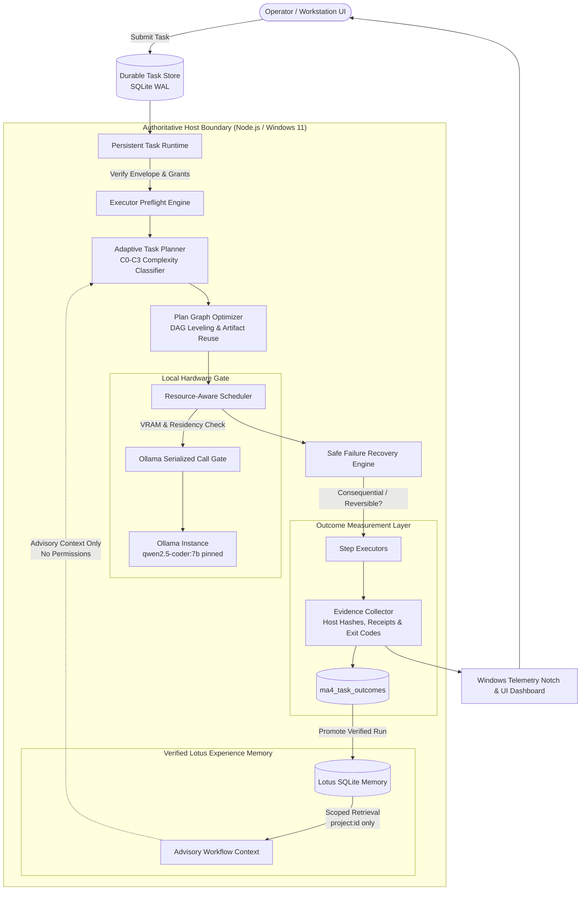

# MA4-S3-T4 Intelligence Architecture

**Product:** Bunny A by LOKAM  
**Milestone:** MA4-S3-T4 (Adaptive Agent Intelligence, Verified Learning & Resource Optimization)  
**Security Boundary:** Workstation Host Controlled, Local Ollama Only (`qwen2.5-coder:7b`)  
**Hardware Reference:** RTX 4050 Laptop GPU (6141 MiB VRAM), Intel Core Ultra 9 185H  

---

## 1. Architectural Philosophy: Verified Outcomes Over LLM Self-Confidence

Prior multi-agent systems often suffer from circular self-justification: an LLM generates a plan, assesses its own execution as "successful", and creates memories reinforcing ineffective or expensive workflows. 

Bunny A MA4-S3-T4 establishes an **authoritative Host-verified architecture** where:
1. **The Host Is Authoritative:** The LLM is an untrusted generator of proposals and text. Only the Host operating system, process receipts, file hashes, and exit codes constitute ground truth.
2. **Terminal State ≠ Success:** A task reaching a `COMPLETED` state does not imply success unless acceptance contracts, required step receipts, and non-empty outputs are cryptographically verified.
3. **No Autonomous Weight Updates:** Intelligence is achieved via verified workflow optimization, topological plan minimization, prompt grounding, and scoped experience retrieval—never through runtime LoRA training, unvetted fine-tuning, or model weights modification.
4. **Advisory Experience Memory:** Retrieved workflow experiences are injected strictly as advisory context. They cannot modify security scopes, expand envelopes, inject unregistered tools, or bypass owner approvals.
5. **Physical Hardware Concurrency Boundaries:** The scheduler treats hardware limits (e.g. 6.1 GiB VRAM on the reference RTX 4050 GPU) as absolute physical invariants, preventing out-of-memory driver crashes by forbidding concurrent 7B parameter local model residency.

---

## 2. End-to-End System Architecture

---

## 3. Subsystem Breakdown

### 3.1 Outcome Measurement Layer (`outcome-measurement.ts`)
- **Tripartite Evidence Separation:**
  - `HostVerifiedEvidence`: Cryptographic SHA256 hashes of input/output, process exit codes, file size deltas, acceptance contract verification, and tool execution receipts.
  - `ModelGeneratedEvidence`: Textual reasoning, proposed steps, tool call candidates, and self-reported summaries.
  - `UserFeedbackEvidence`: Explicit workstation owner ratings, manual approvals, and user corrections.
- **Fail-Closed Verification Contract:** `isVerifiedSuccess(record)` requires `status === "success"`, zero unhandled exceptions, zero acceptance contract violations, and valid step receipts matching the immutable task specification.
- **Secret Redaction:** Automatically scrubs Windows credentials, API keys, Bearer tokens, private paths, and environment secrets prior to persistence.

### 3.2 Adaptive Task Planning (`adaptive-planner.ts`)
- **Deterministic Complexity Tiers (C0–C3):**
  - **C0 (Direct Model):** Conversational questions, pure summarization, code explanation. Uses single direct invocation without tool overhead or multi-agent chatter.
  - **C1 (Single Resource):** Exactly one registered tool or resource root (e.g., read single file, query status). Bounded single-step execution with minimal token footprint.
  - **C2 (Multi-Step DAG):** Independent sub-tasks requiring sequential or parallel processing (e.g. cross-referencing multiple files). Planner decomposes work into a minimal directed acyclic graph.
  - **C3 (High-Risk / Verification Required):** Security-sensitive operations, state mutations, or acceptance verification. Enlists Tester and Reviewer roles for independent verification.
- **Plan Minimization & DAG Leveling:**
  - Prunes redundant steps sharing duplicate input hashes.
  - Groups independent steps into parallel execution levels.
  - Reuses previously verified artifacts when input hashes and permissions remain unchanged.

### 3.3 Safe Failure Recovery & Queue Cancellation (`failure-recovery.ts`, `coordinator.ts`)
- **Seven Deterministic Failure Classes:**
  - `TRANSIENT_RESOURCE_OVERLOAD`: Exponential backoff with jitter (max 2 retries).
  - `MODEL_TIMEOUT`: Single backoff retry within remaining task budget.
  - `TOOL_EXECUTION_ERROR`: Inspect idempotency; retry idempotent reads only.
  - `PERMISSION_DENIED`: Terminal rejection; never retried without owner approval.
  - `POLICY_VIOLATION`: Immediate fail-closed halt; zero retries.
  - `UNCERTAIN_SIDE_EFFECT`: Irreversible interrupted operations enter `UNCERTAIN`; halts until workstation reconciliation.
  - `ACCEPTANCE_UNMET`: Bounded single repair proposal if budget permits.
- **Immediate Waiter Cancellation in Call Gate:** Waiters in `gateCalls` register an `AbortSignal` listener. An aborted waiter is immediately detached from the queue, releasing memory and preventing orphaned background model execution.

### 3.4 Scoped Lotus Experience Learning (`verified-experience.server.ts`)
- **Strict Project Scoping:** Experience records are pinned to `project:<id>`. Queries against `project:alpha` never return experiences created in `project:beta`.
- **Default-Disabled Owner Policy:** Memory collection and retrieval are toggled via owner policy (`enabled: false` by default).
- **Advisory Framing:** Retrieved records are explicitly structured under `<verified_workflow_experience>` tags with disclaimers warning the model that past experiences are suggestions, not authoritative instructions.

### 3.5 Resource-Aware Model Scheduling (`resource-scheduler.ts`)
- **Physical VRAM Enforcement:** RTX 4050 has 6141 MiB dedicated VRAM. Running `qwen2.5-coder:7b` consumes ~4080 MiB VRAM. Dual-model residency would require >8.2 GiB VRAM, risking Windows D3D driver paging or TDR resets. Concurrency is strictly bounded: `canRunInParallel` evaluates to `false` for dual 7B instances, defaulting to serialized grouped execution.
- **NPU Truthful Detection:** Discovers Intel AI Boost NPU (`PCI\VEN_8086&DEV_7D1D`). Evaluates Ollama Windows support and truthfully documents that NPU acceleration is unsupported for GGUF in Ollama 0.40.11, ensuring safe CUDA GPU fallback without false claims.

### 3.6 Bounded Replan & Repair Engine (`replan.server.ts`)
- **Strict Single-Turn Repair Budget:** `MAX_REPAIR_ITERATIONS = 1`. Prevents infinite repair loops.
- **No Acceptance Contract Weakening:** The repair engine strictly rejects any proposed plan modification that removes required acceptance steps or alters the original immutable task contract.
- **Owner Approval Binding:** Modifying any consequential step payload requires fresh operator approval with SHA256 validation.

---

## 4. Security & Privacy Guarantees

1. **No External Egress:** Local model inference occurs strictly on `127.0.0.1:11434`. No cloud LLM fallbacks.
2. **Deterministic Preflight Checks:** Steps must name registered Host tools and files inside registered project roots. Path traversal (`..`) and unregistered roots are blocked prior to task validation.
3. **Hardware Isolation:** All artifacts and SQLite databases reside in local application data roots, protected by Windows DACLs.
