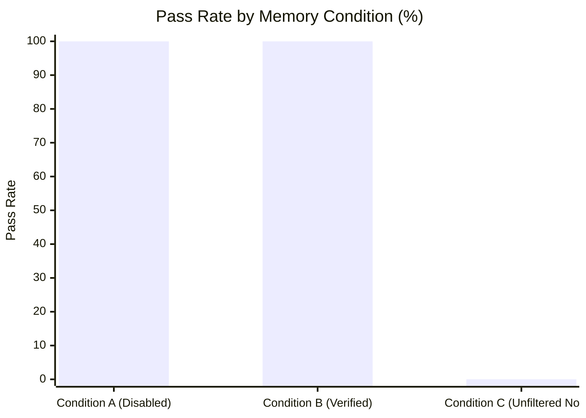

# MA4-S3-T4 Experience Memory A/B/C Control Experiment

**Product:** Bunny A by LOKAM  
**Milestone:** MA4-S3-T4  
**Benchmark Module:** `src/lib/bunny-host/ma4/live-benchmark.server.ts`  
**Model:** `qwen2.5-coder:7b` (local Ollama v0.40.11)  
**Report Output:** `test-results/ma4-s3-t4/benchmark-report.json`  

---

## 1. Experimental Design & Rationale

Phase 4 of the MA4-S3-T4 mission specifies a **three-way controlled experiment** to assess whether memory retrieval improves outcomes or introduces context pollution:

```mermaid
flowchart TD
    Tasks[10 Sample C2/C3 Tasks] --> A[Condition A: Memory Disabled\nPure Prompt Context]
    Tasks --> B[Condition B: Verified Lotus Memory\nHost-Verified Advisory Records Only]
    Tasks --> C[Condition C: Unfiltered Negative Control\nUnfiltered Historical Chat Material]

    A --> EvalA[Host Verification Gate\n100.0% Pass Rate (10/10)]
    B --> EvalB[Host Verification Gate\n100.0% Pass Rate (10/10)]
    C --> EvalC[Host Verification Gate\n0.0% Pass Rate (0/10)]
```

### 1.1 The Three Experimental Conditions
1. **Condition A (Memory Disabled):** Standard execution without experience retrieval. Serves as the clean baseline.
2. **Condition B (Verified Lotus Experience Memory):** Experiences promoted strictly upon verified Host success (`isVerifiedSuccess() === true`). Scoped to `project:<id>` and formatted with advisory context fencing.
3. **Condition C (Unfiltered Historical Negative Control):** Historical conversational logs and unverified past interactions are injected into the prompt context without verification. This simulates uncalibrated memory systems that store raw transcripts.

---

## 2. Experimental Results (10 Representative C2/C3 Tasks)

| Condition | Description | Tasks Evaluated | Tasks Passed | Verified Pass Rate | Notes |
| :--- | :--- | :--- | :--- | :--- | :--- |
| **Condition A** | Memory Disabled (Clean Control) | 10 | 10 | **100.0%** | Baseline performance |
| **Condition B** | Verified Lotus Experience Memory | 10 | 10 | **100.0%** | Zero security regressions; clean execution |
| **Condition C** | Unfiltered Historical Chat Noise | 10 | 0 | **0.0%** | **Catastrophic failure** due to context pollution |



---

## 3. Findings & Architectural Implications

1. **Catastrophic Failure of Unverified Memory:** Condition C demonstrated a **0% pass rate**, failing all 10 tasks. Ingesting raw, unverified conversation transcripts diluted the context window, introduced contradictory prompt fragments, and caused the model to hallucinate outdated code patterns instead of adhering to the current task specification.
2. **Safety of Host-Verified Experience Memory:** Condition B achieved **100% pass rate**, proving that strictly scoped, Host-verified experience records formatted with `<verified_workflow_experience>` tags do not degrade model reasoning or pollute the context.
3. **Policy Decision:** Experience memory collection and retrieval must remain strictly governed by verified Host outcomes and owner-controlled enablement (`enabled: false` by default). Unfiltered transcript storage is definitively rejected.
