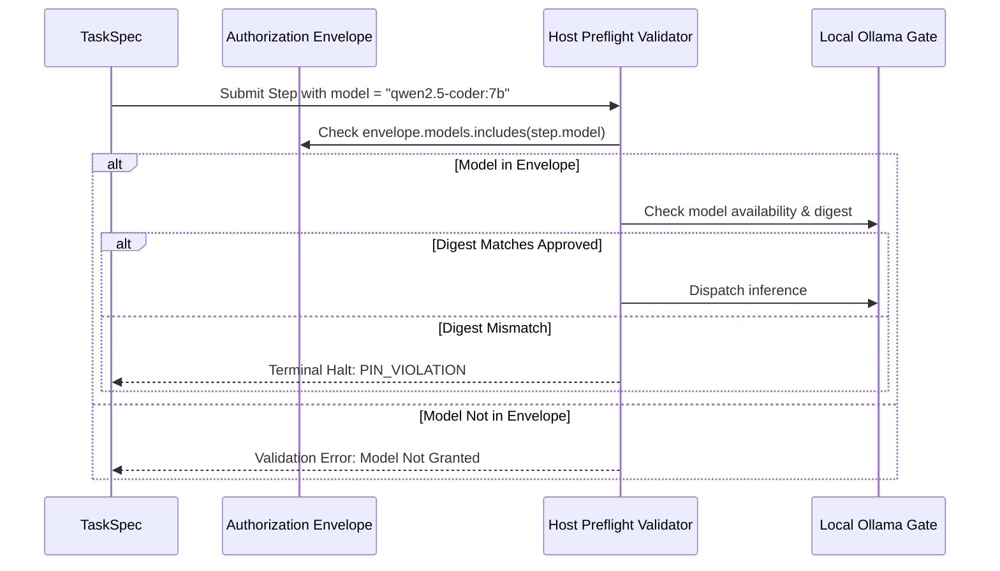

# MA4-S3-T4 Model Assignment and Hard Pin Enforcement

**Product:** Bunny A by LOKAM  
**Milestone:** MA4-S3-T4  
**Enforcement Module:** `src/lib/bunny-host/ma4/task-runtime.server.ts`, `src/lib/bunny-host/ma4/task-runtime.ts`  

---

## 1. Local Model Qualification and Pin Policy

Bunny A operates strictly under local workstation control. To ensure deterministic, reproducible, and secure behavior:
1. Every GPU-assisted step must explicitly pin an approved local model name.
2. The pinned model must exist in the owner's authorization envelope.
3. The served model running in Ollama must match the approved digest.
4. **No Dynamic Substitution:** The Host never silently falls back to another local model or routes queries to an external cloud API if the pinned model is unavailable.

---

## 2. Approved Model Identity

| Property | Value |
| :--- | :--- |
| **Model Name** | `qwen2.5-coder:7b` |
| **Ollama Tag** | `qwen2.5-coder:7b` |
| **Sha256 Digest** | `dae161e27b0e90dd1856c8bb3209201fd6736d8eb66298e75ed87571486f4364` |
| **Format** | GGUF Q4_K_M |
| **Quantization** | 4-bit Medium K-quantization |
| **Context Window** | 32,768 tokens (tested at 4,096 in standard tasks) |
| **Parameters** | 7.61 Billion |
| **Locality** | `localOnly: true` (Strict localhost loopback `127.0.0.1:11434`) |

---

## 3. Role-to-Model Assignment

Under the MA4 collaborative architecture, multi-agent roles are mapped to local model execution:

| Role | Responsibilities | Assigned Model | Enforcement |
| :--- | :--- | :--- | :--- |
| **Planner** | Problem decomposition, dependency DAG synthesis | `qwen2.5-coder:7b` | Hard pinned in `TaskSpec.steps` |
| **Worker** | Code editing, AST transformation, tool invocation | `qwen2.5-coder:7b` | Hard pinned in `TaskSpec.steps` |
| **Tester** | Test generation, execution analysis, receipt verification | `qwen2.5-coder:7b` | Hard pinned in `TaskSpec.steps` |
| **Reviewer** | Security boundary verification, diff inspection | `qwen2.5-coder:7b` | Hard pinned in `TaskSpec.steps` |

---

## 4. Hard Pin Enforcement Lifecycle



### 4.1 Preflight Rejection
If a step specifies a model not listed in `envelope.models`:
```typescript
if (step.model && !envelope.models.includes(step.model)) {
  problems.push(`Model ${step.model} is not in the envelope.`);
}
```
Validation halts immediately. The task never transitions to `QUEUED`.

### 4.2 Runtime Pin Violation Halt
If a task attempts to dispatch inference to an unapproved model at runtime:
- The task is immediately transitioned to `FAILED`.
- The failure code is recorded as `PIN_VIOLATION`.
- The violation is surfaced in the Windows GUI telemetry notch.
- Zero retry attempts are permitted.
