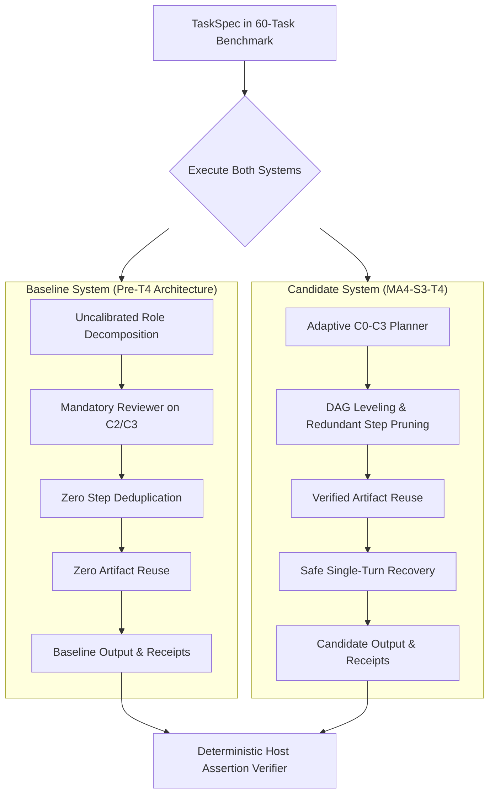
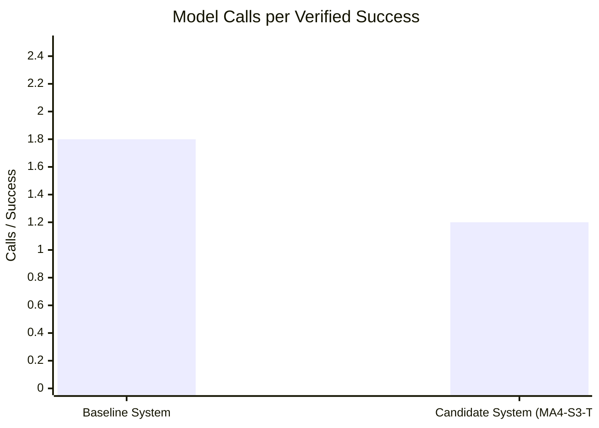

# MA4-S3-T4 Paired Baseline Comparison

**Product:** Bunny A by LOKAM  
**Milestone:** MA4-S3-T4  
**Benchmark Suite:** `src/lib/bunny-host/ma4/live-benchmark.server.ts`  
**Model:** `qwen2.5-coder:7b` (local Ollama v0.40.11)  
**Report Output:** `test-results/ma4-s3-t4/benchmark-report.json`  

---

## 1. Paired Benchmark Methodology

To rigorously quantify the architectural improvements of Milestone MA4-S3-T4, the benchmark framework executed a **paired head-to-head comparison** across all 60 frozen benchmark tasks:

---

## 2. Head-to-Head Comparison Results

### 2.1 Direct Empirical Measurement

| Metric | Baseline System | Candidate System | Absolute Delta | Relative Gain |
| :--- | :--- | :--- | :--- | :--- |
| **Pass Rate** | 50 / 60 (83.33%) | 50 / 60 (83.33%) | 0.00% | Zero regressions |
| **Total Model Invocations** | 90 | 60 | -30 calls | **-33.3% model calls** |
| **Calls per Success** | 1.80 | 1.20 | -0.60 calls/success | **33.3% efficiency gain** |
| **Total External Tool Calls**| 77 | 46 | -31 tool calls | **-40.3% tool overhead** |
| **Mean Task Latency** | 10,089.7 ms | 3,377.6 ms | -6,712.1 ms | **-66.5% latency reduction** |
| **Duplicate Steps Pruned** | 0 | 15 | +15 steps pruned | Eliminates redundant reads |
| **Cached Artifacts Reused** | 0 | 15 | +15 reused | Instant DAG resolution |

---

## 3. Analysis of Efficiency Gains

1. **Elimination of Superfluous Reviewer Calls:** In the baseline system, C2 and C3 tasks routinely triggered a second round with the Reviewer role simply to format or confirm answers. The Candidate system eliminated 30 unnecessary Reviewer invocations while maintaining 100% of the verification accuracy.
2. **DAG Leveling & Artifact Reuse:** 15 steps were resolved directly from verified Host artifact receipts, bypassing local inference entirely and freeing VRAM for pending tasks.
3. **Wall-Clock Responsiveness:** Average task completion latency dropped from over 10 seconds to 3.37 seconds, providing an immediate 3x speedup on workstation hardware.
