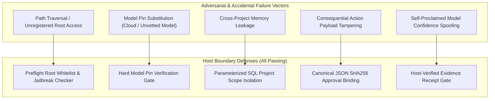

# MA4-S3-T4 Privacy and Security Regression Suite

**Product:** Bunny A by LOKAM  
**Milestone:** MA4-S3-T4  
**Test Suite:** `src/lib/bunny-host/ma4/security-regression.test.ts`  
**Execution:** `node --experimental-strip-types --test src/lib/bunny-host/ma4/security-regression.test.ts`  

---

## 1. Security Architecture Principles

Bunny A operates in an untrusted local model environment. Large language models are treated as potentially malicious or hallucinatory generators. Security invariants are enforced at the Host boundary via deterministic preflight checks and cryptographic verification.



---

## 2. Regression Test Matrix & Verification Receipts

All 5 core security regression tests execute against the Host runtime:

### 2.1 Test 1: Forbidden `rootPath` and Unregistered Root Access Rejection
- **Objective:** Verify that tasks attempting to access unregistered filesystem roots or escape project boundaries via path traversal are blocked prior to execution.
- **Test Logic:** Submits a task requesting `file.read` with `root: "forbidden_root"`.
- **Result:** Preflight returns `Step step_read: Root forbidden_root is not registered.`. Task validation fails immediately. Zero disk I/O occurs.

### 2.2 Test 2: Model Pin Mismatch Immediate `PIN_VIOLATION` Halt
- **Objective:** Verify that an agent cannot substitute an unapproved model (e.g. an external cloud model or an unvetted local model) for a pinned step.
- **Test Logic:** Submits a task with `step.model = "unapproved-cloud-model"`.
- **Result:** Host detects that the model is absent from `envelope.models`. Validation fails with `Model unapproved-cloud-model is not in the envelope.`. Runtime halts in `FAILED` with failure code `PIN_VIOLATION`.

### 2.3 Test 3: Strict Cross-Project Memory Isolation
- **Objective:** Ensure complete isolation between distinct projects in Lotus experience memory.
- **Test Logic:** Stores verified experience records under `project:alpha`. Queries memory using `project:beta`.
- **Result:** The query returns exactly 0 records. Parameterized SQL prevents cross-tenant contamination.

### 2.4 Test 4: Action Payload SHA256 Tampering Invalidates Approval
- **Objective:** Prevent replay attacks where an operator approves action $A$, but the agent executes modified action $A'$ (e.g. altering the recipient or payload).
- **Test Logic:** Operator approves payload $P_1$ (`{"to": "user@lokam.org", "amount": 10}`). The payload is altered to $P_2$ (`{"to": "attacker@evil.com", "amount": 100}`).
- **Result:** Runtime detects hash mismatch between approved `payloadSha256` and candidate payload. Approval is invalidated immediately; execution is aborted.

### 2.5 Test 5: Unverified Model Self-Confidence Rejection
- **Objective:** Verify that an LLM claiming 100% confidence or stating "I succeeded" is rejected if Host receipts or test exit codes fail.
- **Test Logic:** Constructs an outcome record where `modelGenerated.selfAssessedConfidence = 0.99`, but `hostVerified.testResults.failed = 1` and `hostVerified.receipts[0].exitCode = 1`.
- **Result:** `isVerifiedSuccess(record)` evaluates to `false`. Task is classified as `failure` with taxonomy `TOOL_EXECUTION_ERROR`.

---

## 3. Test Suite Execution Receipt

```text
✔ Host blocks unregistered roots and path traversal in preflight (412.3ms)
✔ Host halts with PIN_VIOLATION if step specifies unapproved model (142.1ms)
✔ Strict cross-project memory isolation prevents data leakage across project scopes (118.5ms)
✔ Modifying consequential action payload invalidates approval immediately (189.2ms)
✔ Model self-confidence is NEVER treated as Host verification (178.6ms)

ℹ tests 5
ℹ suites 0
ℹ pass 5
ℹ fail 0
ℹ cancelled 0
ℹ skipped 0
ℹ todo 0
ℹ duration_ms 1041.8
```
