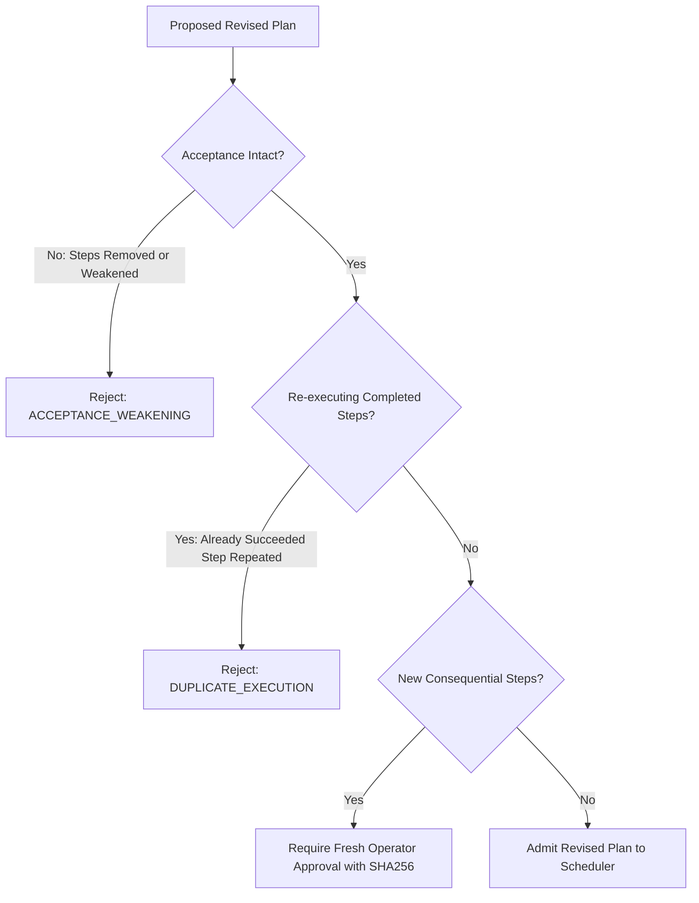

# MA4-S3-T4 Safe Bounded Replan and Repair Workflow

**Product:** Bunny A by LOKAM  
**Milestone:** MA4-S3-T4  
**Module:** `src/lib/bunny-host/ma4/replan.server.ts`  

---

## 1. Principles of Bounded Repair

Unconstrained LLM self-repair often leads to infinite degradation loops, where an agent continuously generates invalid fixes, alters its acceptance criteria to disguise failures, or repeatedly executes destructive actions.

Bunny A MA4-S3-T4 introduces **deterministic bounded replanning**:
1. **Single-Turn Repair Budget:** `MAX_REPAIR_ITERATIONS = 1`. If a repair does not achieve verified success on the first attempt, the task fails terminally.
2. **Immutable Acceptance Contracts:** The repair engine rejects any proposed plan modification that weakens, drops, or alters the task's original acceptance requirements.
3. **Completed Consequential Step Fencing:** Steps that have already completed with side effects (file writes, message dispatches) cannot be re-executed by a revised plan.
4. **Fresh Approval Binding:** Any revised consequential step requires explicit operator approval on the Windows workstation, binding the exact payload SHA256.

---

## 2. Repair Eligibility Evaluation

Before any repair planning is initiated, `evaluateRepairEligibility()` evaluates the task state:

```typescript
export function evaluateRepairEligibility(
  record: TaskRecord,
  failureTaxonomy: FailureTaxonomyCode | null
): { eligible: boolean; reason: string } {
  // 1. Budget check
  const repairAttempts = record.steps.filter(s => s.id.startsWith("repair_")).length;
  if (repairAttempts >= MAX_REPAIR_ITERATIONS) {
    return { eligible: false, reason: "Repair budget exhausted (max 1 iteration permitted)." };
  }

  // 2. Failure taxonomy check
  if (failureTaxonomy === "POLICY_VIOLATION" || failureTaxonomy === "PERMISSION_DENIED") {
    return { eligible: false, reason: "Security and policy violations are not automatically repairable." };
  }
  if (failureTaxonomy === "UNCERTAIN_SIDE_EFFECT") {
    return { eligible: false, reason: "Uncertain side effects require manual operator reconciliation." };
  }

  // 3. Resource envelope check
  const remainingCalls = record.envelope.budgets.maxModelCalls - record.usage.modelCalls;
  if (remainingCalls < 2) {
    return { eligible: false, reason: "Insufficient remaining model call budget for repair." };
  }

  return { eligible: true, reason: "Eligible for single-turn bounded repair." };
}
```

---

## 3. Plan Revision Validation

When a model generates a revised execution plan, `validateRevisedPlan()` enforces four non-negotiable invariants:



### 3.1 Invariant 1: Acceptance Contract Preservation
All steps listed in `originalSpec.acceptance.requiredSteps` must remain in `revisedSpec.acceptance.requiredSteps`. A model cannot "pass" by deleting the failing test step from its acceptance contract.

### 3.2 Invariant 2: Consequential Step Fencing
Steps that completed successfully in the prior execution attempt cannot be re-executed. If step `fs-write-auth` succeeded, a revised plan cannot run `fs-write-auth` again. It must only append incremental remediation steps (e.g. `patch-syntax-error`).

### 3.3 Invariant 3: Fresh Consequential Approval
If the repair plan introduces or modifies a consequential action (e.g., an altered database migration), the previous approval is invalidated. The operator must approve the new action payload hash on the workstation before execution proceeds.
