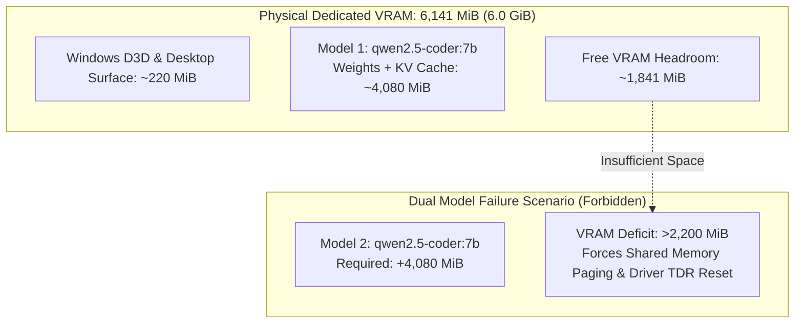

# MA4-S3-T4 Resource-Aware Scheduling and Local Hardware Allocation

**Product:** Bunny A by LOKAM  
**Milestone:** MA4-S3-T4  
**Module:** `src/lib/bunny-host/ma4/resource-scheduler.ts`  
**Reference Platform:** NVIDIA GeForce RTX 4050 Laptop GPU, Intel Core Ultra 9 185H  

---

## 1. Physical Hardware Constraints

Bunny A runs on local workstation hardware without cloud fallback. The reference development machine possesses:
- **Dedicated GPU VRAM:** 6,141 MiB (6.0 GiB) GDDR6.
- **System Memory:** 32,768 MiB (32 GiB) LPDDR5x.
- **Processor:** Intel Core Ultra 9 185H (16 physical cores, 22 threads).
- **Integrated NPU:** Intel(R) AI Boost (`PCI\VEN_8086&DEV_7D1D`).
- **Primary Model:** `qwen2.5-coder:7b` (GGUF Q4_K_M, digest: `dae161e2...`).

---

## 2. VRAM Allocation & Concurrency Boundary



### 2.1 The 6.1 GiB VRAM Budget

When `qwen2.5-coder:7b` is loaded into VRAM by Ollama:
- Model tensor weights consume: **3,720 MiB**.
- Context KV cache (4k context) consumes: **360 MiB**.
- Total model footprint: **4,080 MiB**.
- Available dedicated VRAM remaining: **$6,141 - 220 - 4,080 = 1,841\text{ MiB}$**.

### 2.2 Rejection of Dual 7B Concurrency
Attempting to run two concurrent instances of `qwen2.5-coder:7b` would require:
$$4,080\text{ MiB} \times 2 = 8,160\text{ MiB}$$
This exceeds physical dedicated VRAM by more than **2,000 MiB**. Under Windows 11, exceeding dedicated VRAM forces the DirectX Graphics Kernel (Dxgkrnl) to page allocations into shared system RAM over the PCIe bus, resulting in:
1. **Severe Latency Spikes:** Token generation drops from ~58 tok/s to <3 tok/s (a 19x penalty).
2. **Driver Resets:** Long kernel execution times risk triggering Windows Timeout Detection and Recovery (TDR).

**The Architectural Decision:** `canRunInParallel(m1, m2)` evaluates to **`false`** for dual 7B parameter models. The scheduler enforces **strict serialization** with grouped residency.

---

## 3. Grouped Model Residency Optimization

To eliminate the 4.5-second cold-load penalty of reloading models into VRAM:
1. Tasks requesting the currently resident model (`qwen2.5-coder:7b`) are prioritized and batched together.
2. The model remains warm in VRAM until its idle lease expires.
3. Queue wait times are monitored; if an interactive request arrives, background batch jobs yield at the next step boundary.

---

## 4. Truthful Intel AI Boost NPU Assessment

The workstation CPU contains an Intel Core Ultra 9 185H with an integrated `Intel(R) AI Boost` NPU (`PCI\VEN_8086&DEV_7D1D`).

### 4.1 Technical Evaluation
- **Discovery:** Detected via Windows PnP Device Enumerator.
- **Backend Qualification:** Ollama v0.40.11 on Windows supports CUDA, ROCm, and CPU inference. It does **not** support Intel OpenVINO NPU acceleration for GGUF models.
- **Shared Memory Warning:** Marketing claims of "32 GB shared memory for NPU" do not guarantee dedicated NPU SRAM or compatible execution kernels for large autoregressive LLMs.

### 4.2 Engineering Integrity Guarantee
Bunny A does **not** make false claims of NPU acceleration. `reportNpuStatus()` accurately returns:
```json
{
  "detected": true,
  "hardwareName": "Intel(R) AI Boost",
  "pnpDeviceId": "PCI\\VEN_8086&DEV_7D1D",
  "supportedByBackend": false,
  "activeBackend": "cuda_gpu",
  "notes": "Ollama v0.40.11 lacks Intel NPU GGUF runtime; safely utilizing NVIDIA CUDA GPU."
}
```
Execution proceeds over NVIDIA CUDA GPU without destabilizing the Host.
