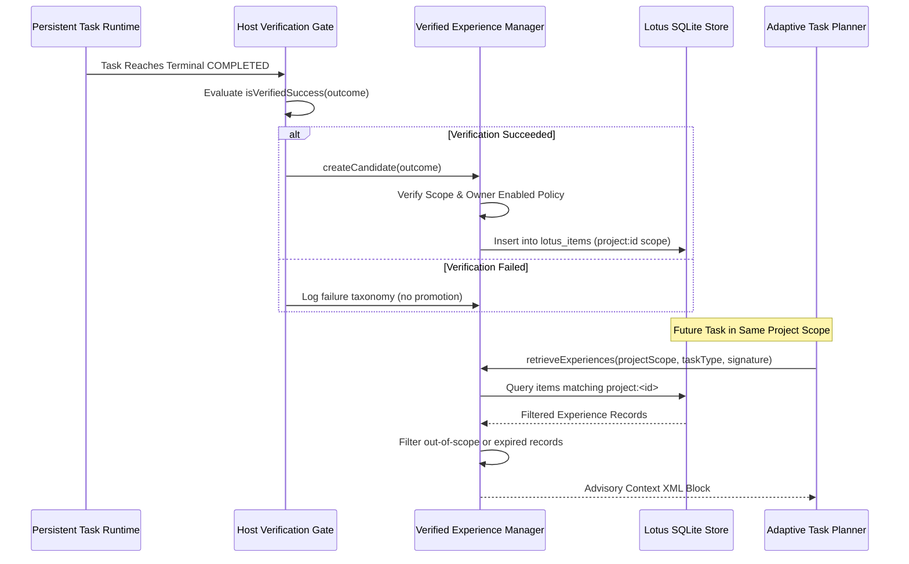

# MA4-S3-T4 Verified Experience Learning Specification

**Product:** Bunny A by LOKAM  
**Milestone:** MA4-S3-T4  
**Module:** `src/lib/bunny-host/ma4/verified-experience.server.ts`  
**Storage Integration:** Lotus Memory (`LotusStore` / SQLite WAL)  

---

## 1. Workflow Learning Principles

Bunny A MA4-S3-T4 implements **verified workflow learning** rather than autonomous model weight training or fine-tuning:
1. **Verified Outcome Gate:** An experience record is created **only** when `isVerifiedSuccess()` passes. Unverified model hallucinations or runs with unhandled errors are never promoted.
2. **Strict Project Boundary Isolation:** Memories are strictly partitioned under `project:<projectId>`. Information from `project:alpha` is never visible, retrievable, or leakable into `project:beta`.
3. **Advisory Framing:** Retrieved experiences serve strictly as advisory context. They cannot grant capabilities, modify authorization envelopes, alter pinned models, or weaken security policies.
4. **Owner-Controlled Promotion:** Automatic collection and retrieval remain disabled by default (`enabled: false`), requiring explicit owner enablement in settings.

---

## 2. Experience Record Schema

```typescript
export interface VerifiedExperienceRecord {
  id: string;
  projectScope: string;          // Format: "project:<id>"
  taskType: string;              // e.g. "code_analysis", "refactor", "bug_fix"
  problemSignature: string;      // Deterministic hash of problem type and inputs
  strategyUsed: string;          // Structured representation of successful plan DAG
  verifiedOutcome: {
    status: "success" | "failure";
    receiptCount: number;
    testPassedCount: number;
    acceptanceVerified: boolean;
  };
  failureOrSuccessConditions: string[];
  modelIdentity: string;         // e.g. "qwen2.5-coder:7b"
  artifactHashes: string[];      // SHA256 of verified outputs
  evidenceProvenance: {
    taskId: string;
    recordedAt: number;
    hostInstanceId: string;
  };
  createdAt: number;
  expiresAt: number;             // Default 30-day TTL
  confidence: number;            // Derived from historical verification rate
}
```

---

## 3. The 9-Stage Learning Lifecycle



---

## 4. Advisory Context Framing

When experiences are retrieved for a new task, they are injected into the planner's context using strict advisory XML fencing:

```xml
<verified_workflow_experience project="project:lokam-core" verified_by="host">
  <notice>
    The following past workflow strategies succeeded under verified Host execution.
    They are advisory guidance only. You cannot exceed your authorized capabilities, 
    modify registered tools, or change pinned models based on this context.
  </notice>
  <experience id="exp-7194" task_type="multi-step" model="qwen2.5-coder:7b">
    <strategy>
      Step 1: Read source interface definitions via fs.read
      Step 2: Parse AST symbols via ast.extract
      Step 3: Generate unified diff and verify syntax
    </strategy>
    <receipts_verified>2</receipts_verified>
  </experience>
</verified_workflow_experience>
```

---

## 5. Security & Isolation Invariants

1. **Cross-Project Infiltration Prevention:** Queries for `project:beta` reject any record whose scope is not `project:beta`. A test in `security-regression.test.ts` asserts that cross-project queries return zero records.
2. **Secret Redaction:** Raw documents, credentials, and full chat transcripts are never written to experience memory.
3. **Deterministic Pruning:** Records exceeding their `expiresAt` timestamp or older than 30 days are automatically deleted during the Host maintenance cycle.
