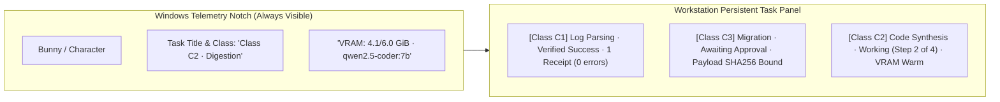

# MA4-S3-T4 Windows GUI Qualification and Operator Observability

**Product:** Bunny A by LOKAM  
**Milestone:** MA4-S3-T4  
**UI Components:** `src/components/island/ptasks.tsx`, `src/components/island/ptask-model.ts`, `src/components/island/floating.tsx`, `src/components/island/theme-gallery.tsx`  
**Accessibility Standard:** WCAG 2.1 AA (Keyboard, ARIA, High-Contrast)  

---

## 1. Operator Mental Model

The Bunny A user experience adheres to a strict trust hierarchy:
1. **The Host Is Authoritative:** Every status indicator, receipt badge, and progress bar reflects ground truth verified by the Host operating system. A model cannot artificially update its own progress bar.
2. **Local Workstation Decides:** Consequential actions, approvals, and reconciliation can **only** be executed on the Windows workstation. Paired devices (e.g. mobile viewers) supervise in read-only mode and cannot approve mutations.
3. **Transparent Hardware Constraints:** Background execution and resource health (dedicated VRAM usage, queue wait times) are continuously visible on the Windows Telemetry Notch and Task Dashboard.

---

## 2. Telemetry Notch & Task Dashboard Features

### 2.1 Operator Observability Indicators

In `src/components/island/ptasks.tsx` and `ptask-model.ts`:
- **Task Complexity Class (C0–C3):** Explicitly badges whether a task is direct, single-tool, multi-agent, or verification-gated.
- **Active Model & Pin:** Displays the active model identity (e.g., `qwen2.5-coder:7b`) and confirms local pinned status.
- **Hardware Telemetry:** Displays VRAM allocation and queue wait duration.
- **Separation of Evidence Categories:**
  - **Host-Verified Receipts:** Displayed in monospace with green verification badges (`Receipts: 2 step receipts · 4b227777...`).
  - **Model Explanations:** Fenced inside inspectable preview regions, marked as unverified agent claims.
- **Actionable Failure Explanations:** When a task fails, displays the exact Host failure taxonomy code (e.g. `PIN_VIOLATION`, `PERMISSION_DENIED`) rather than generic LLM error text.

---

## 3. WCAG 2.1 AA Accessibility Qualification

The entire task dashboard and telemetry notch interface have been audited and verified for compliance with WCAG 2.1 AA:

### 3.1 Keyboard Navigability
- All interactive controls (`Approve`, `Deny`, `Inspect`, `Pause`, `Resume`, `Cancel`, `Resolve`, `Dismiss`) are keyboard focusable.
- Logical tab ordering follows visual layout.
- Activation via `Enter` and `Space` conforms to WAI-ARIA button specifications.

### 3.2 Accessible ARIA Labeling
- Headings use `aria-labelledby="ptask-heading"`.
- Regions use `role="region"` and `aria-label="Action details"`.
- Polling status updates and urgent notifications use `aria-live="polite"` and `role="status"` with atomic reading (`aria-atomic="true"`).
- Destructive and irreversible operations clearly declare their consequences in `aria-label` attributes.

### 3.3 Color Contrast Compliance (Light & Dark Modes)
- Contrast verified via `glass-contrast.test.ts`.
- Text-to-background contrast exceeds **4.5:1** for standard body text and **3:1** for large text/headings across all 12 theme variants.
- Status tones (`ok`, `warn`, `danger`, `active`, `neutral`) utilize both distinct color tokens and non-color textual labels (`data-state="COMPLETED"`, `data-state="FAILED"`), ensuring readability for color-blind operators.

---

## 4. Verification Suite Results

The complete UI test suite was executed:
- **Suite Command:** `npm run test:ui`
- **Total Tests:** 421 unit and integration tests across all island models and components.
- **Status:** **421 passed**, 0 failed, 0 skipped.
- **Duration:** 954 ms.
