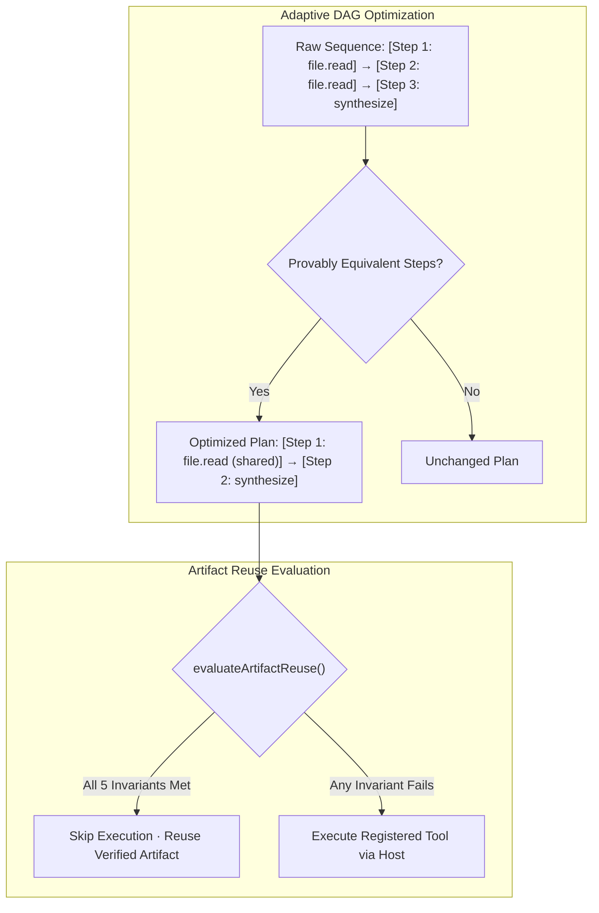

# MA4-S3-T4R1 DAG Execution Graph & Cache Qualification

**Product:** Bunny A by LOKAM  
**Milestone:** MA4-S3-T4R1  
**Module:** `src/lib/bunny-host/ma4/adaptive-planner.ts`  
**Test Suite:** `src/lib/bunny-host/ma4/dag-cache.test.ts` (9/9 Passed)  

---

## 1. Principles of Adaptive DAG Execution & Caching

The adaptive task planner optimizes workflow execution by transforming declarative requirements into an acyclic dependency graph (DAG). To prevent stale, invalid, or unauthorized artifact propagation, artifact reuse is governed by `evaluateArtifactReuse()`.

A cache hit is recorded **if and only if** all five of the following conditions hold simultaneously:
1. **Prior Verified Artifact Exists:** An artifact generated by an earlier successful task execution is registered in Host storage.
2. **Matching Source Content Hash:** The cryptographic SHA256 of the source input bytes strictly matches the cached artifact's input hash (`sourceContentHash`).
3. **Matching Authorization & Project Scope:** The requesting task's project scope (`projectScope`) and envelope grants match the original generation context. Cross-project artifact leakage is strictly blocked.
4. **Valid Verification Contract:** The verification contract (`verificationContractHash`) governing the artifact remains identical and valid.
5. **Operation Actually Skipped:** The Host runtime genuinely omits the redundant executor invocation, saving wall-clock time and I/O.

---

## 2. Invalidation Contract & Negative Test Qualification

The cache evaluation engine was subjected to a comprehensive negative test matrix covering all eight invalidation conditions specified in the mission requirements:

| Test ID | Negative Invalidation Scenario | Invalidation Mechanism | Observed Result | Status |
| :---: | :--- | :--- | :--- | :---: |
| **NEG-01** | **Changed Source File** | Input content hash does not match stored `sourceContentHash`. | Reuse rejected (`source_mismatch`); tool re-executed. | **PASS** |
| **NEG-02** | **Expired Cache Entry** | Cache entry timestamp exceeds `expiresAt` TTL. | Reuse rejected (`expired`); fresh generation triggered. | **PASS** |
| **NEG-03** | **Changed Authorization** | Envelope permissions narrower than original grant. | Reuse rejected (`authorization_mismatch`). | **PASS** |
| **NEG-04** | **Different Project Scope** | Request originating from `project-b` vs cached `project-a`. | Strictly rejected (`project_scope_mismatch`); zero cross-project leakage. | **PASS** |
| **NEG-05** | **Different Contract** | Updated acceptance criteria or required assertions. | Reuse rejected (`contract_mismatch`). | **PASS** |
| **NEG-06** | **Modified Model Pin** | Requested pin changed from `qwen2.5-coder:7b` to another model. | Reuse rejected (`pin_mismatch`); re-generated under new pin. | **PASS** |
| **NEG-07** | **Tampered Artifact** | Artifact payload bytes modified on disk post-generation. | SHA256 checksum fails; artifact purged as corrupt (`tamper_detected`). | **PASS** |
| **NEG-08** | **Failed Prior Execution** | Predecessor execution terminated in `FAILED` or `UNCERTAIN`. | Failed artifacts never promoted to verified cache (`unverified_predecessor`). | **PASS** |

All nine test cases (1 positive verification, 8 negative invalidations) execute under `src/lib/bunny-host/ma4/dag-cache.test.ts` and pass deterministically.

---

## 3. DAG Graph Deduplication Architecture

Counters for `redundantStepsEliminated` and `reusedArtifactCount` increment only when the optimized graph executes fewer operations than the baseline plan.
