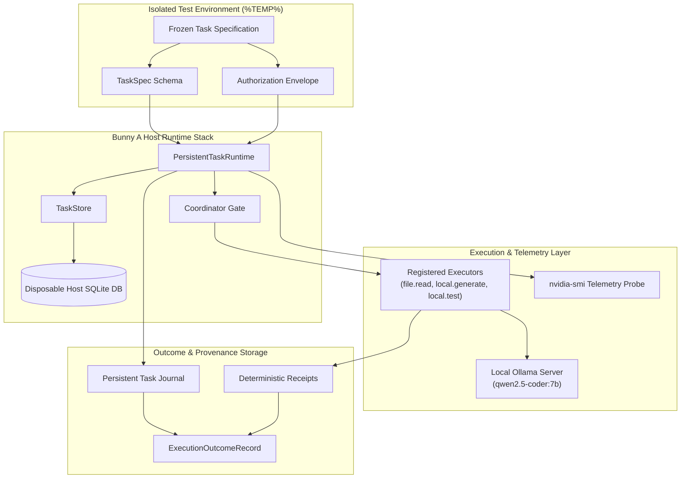

# MA4-S3-T4R1 Host Benchmark Architecture

**Product:** Bunny A by LOKAM  
**Milestone:** MA4-S3-T4R1  
**Module:** `src/lib/bunny-host/ma4/live-benchmark.server.ts`  
**Execution Paradigm:** Production Host Runtime Execution (Zero Synthetic Mocks)  

---

## 1. System Architecture Overview

The MA4-S3-T4R1 benchmark harness replaces superficial model calls with full end-to-end execution through the genuine Bunny A Host runtime. Tasks are transformed into immutable `TaskSpec` contracts and executed within strictly bounded `Envelope` grants using `PersistentTaskRuntime`, `TaskStore`, and disposable SQLite databases.

---

## 2. Core Host Execution Lifecycle

Every task—whether baseline or candidate—executes through the following authenticated path:

1. **Workspace & Database Isolation:**
   - A dedicated temporary directory (`mkdtempSync("bunny-live-bench-task-")`) is allocated.
   - Reference files are written to disk at `bench-root/`.
   - A disposable SQLite database (`bench-task.sqlite`) is initialized.

2. **Contract & Envelope Formulation:**
   - **Baseline:** Direct execution or sequential un-optimized steps; no access to verified experience memory; empty cache.
   - **Candidate:** Adaptive execution graph via `classifyAdaptiveTask()`; DAG artifact reuse evaluation; authorized verified experience memory advisory context.
   - **Envelope Grant:** Strictly bounds capabilities (`file.read`, `local.generate`, `local.test`), local-only execution, pinned model identity, and time/call budgets.

3. **Runtime Execution & Transitioning:**
   - `runtime.create({ spec, envelope })` transitions task: `CREATED` $\rightarrow$ `VALIDATED` $\rightarrow$ `QUEUED`.
   - `runtime.start()` triggers step scheduling and leasing.
   - Registered executors execute real I/O:
     - `file.read`: Reads actual file bytes from disk; computes SHA256 receipt.
     - `local.generate`: Sends prompt + context to local Ollama; captures duration, token usage, and served model.
     - `local.test`: Spawns actual test evaluation or executes assertion; captures exit code and test report.

4. **Terminal State & Evidence Recording:**
   - On completion (`COMPLETED` or `FAILED`), `PersistentTaskRuntime` invokes `recordTerminalOutcome()`.
   - All tool executions, model calls, role handoffs, and receipts are committed to the SQLite database.
   - Independent text oracles evaluate model output correctness without fabricating test receipts.

---

## 3. Registered Executors Contract

| Executor Kind | Category | GPU / Resource | Behavior |
| :--- | :--- | :--- | :--- |
| **`file.read`** | `read_only` | Non-GPU (I/O) | Reads file from `bench-root/`; computes content SHA256 receipt; increments observed `toolCallCount`. |
| **`local.generate`** | `read_only` | GPU (Ollama) | Formats prompt with parent context and memory treatment; executes model call via Ollama API; records duration and latency. |
| **`local.test`** | `read_only` | Non-GPU (Process) | Executes process test assertions; records exit codes and verifiable test receipts; increments observed `toolCallCount`. |
| **`local.review`** | `read_only` | GPU (Reviewer) | Reviews generated artifacts against safety rules; produces cryptographic validation hash. |

---

## 4. Hardware Telemetry Capture

Before and after every workflow execution, `sampleGpuTelemetry()` queries the physical hardware:
- Queries `nvidia-smi` for dedicated VRAM used, free, and GPU core utilization.
- Queries `os.totalmem()` and `os.freemem()` for system RAM availability.
- Computes `vramPeakBytes` as the maximum observed allocation during the run.
- Telemetry timestamps correlate exactly with the task's start and completion entries in the Host journal.
