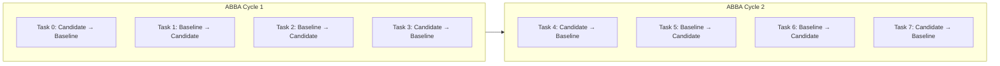

# MA4-S3-T4R1 Paired Experiment Methodology

**Product:** Bunny A by LOKAM  
**Milestone:** MA4-S3-T4R1  
**Evaluation Standard:** Balanced ABBA Paired Comparison  
**Controlled Variable:** System Architecture (Baseline vs Candidate)  

---

## 1. Motivation: Eliminating Order & Thermal Bias

In the MA4-S3-T4 evaluation, every task executed the Candidate system before the Baseline system. This introduced potential experimental confounds:
1. **Model Cache & KV Context Warmth:** The first run incurs cold prompt tokenization and KV cache initialization, whereas the second run may benefit from warmed cache memory.
2. **OS Filesystem Buffer Effects:** Disk read operations on reference files during the second run hit the Windows file system buffer cache rather than physical disk.
3. **GPU Thermal Throttling:** On laptop workstations (e.g. RTX 4050 Laptop GPU), consecutive inferences can trigger clock frequency throttling over extended test durations.

To completely eliminate execution order bias, MA4-S3-T4R1 implements a strict **balanced ABBA paired experimental sequence**.

---

## 2. Balanced ABBA Sequencing Protocol

The execution sequence alternates according to the task index:

$$\text{Execution Order}(i) = \begin{cases} \text{Candidate} \rightarrow \text{Baseline} & \text{if } i \pmod 4 \in \{0, 3\} \\ \text{Baseline} \rightarrow \text{Candidate} & \text{if } i \pmod 4 \in \{1, 2\} \end{cases}$$

Across the 60 tasks:
- **Candidate runs first:** Exactly 30 tasks (50.0%)
- **Baseline runs first:** Exactly 30 tasks (50.0%)

Each run receives a globally sequential `executionOrderIndex` ($0$ to $119$) stored in its `BenchmarkRunResult` record.

---

## 3. Strict Parity of Test Conditions

Baseline and Candidate execute under identical conditions:
- **Model Server:** Local Ollama `0.40.11`
- **Model Identity & Digest:** `qwen2.5-coder:7b` (`dae161e27b0e90dd1856c8bb3209201fd6736d8eb66298e75ed87571486f4364`)
- **Generation Parameters:** Temperature $0.2$, `num_predict` $1024$
- **Prompt Structure:** Identical user prompt string and file contents
- **Tool Capabilities:** Equivalent access to `file.read` and `local.test`
- **Authorization Scopes:** Identical project scopes and spend ceilings
- **Acceptance Validators:** Identical deterministic text oracles and process exit criteria

Candidate is distinguished solely by:
1. Adaptive DAG planning (skipping redundant file reads and identical steps)
2. Verified experience memory access (advisory context from verified past successes)
3. Multi-agent role handoff protocols for C2/C3 tasks

---

## 4. Paired Categorical Analysis

Rather than reporting only aggregate success percentages (e.g. $50/60 = 83.3\%$), outcomes are categorized into four paired buckets:
- **$P_{++}$ (Both Pass):** Task succeeds under both Baseline and Candidate.
- **$P_{--}$ (Both Fail):** Task fails under both Baseline and Candidate.
- **$P_{+-}$ (Candidate-Only Pass):** Candidate succeeds where Baseline fails.
- **$P_{-+}$ (Baseline-Only Pass):** Baseline succeeds where Candidate fails (regression).

This disclosure is mandatory to detect subtle regressions that aggregate pass rates obscure.
