# MA4-S3-T4R1 Performance & Resource Efficiency Comparison

**Product:** Bunny A by LOKAM  
**Milestone:** MA4-S3-T4R1  
**Hardware Target:** NVIDIA GeForce RTX 4050 Laptop GPU (6,141 MiB Dedicated VRAM)  
**Model Serving:** Ollama `0.40.11` (`qwen2.5-coder:7b`, digest `dae161e27b0e90dd1856c8bb3209201fd6736d8eb66298e75ed87571486f4364`)  

---

## 1. Executive Performance Summary

The candidate system demonstrates substantial improvements in runtime efficiency, tool utilization, and graph execution speed, while preserving local execution integrity:

| Performance Dimension | Baseline System | Candidate System | Delta / Improvement |
| :--- | :---: | :---: | :---: |
| **Overall Pass Rate** | 90.0% (54/60) | 90.0% (54/60) | 0.0% (Identical Accuracy) |
| **Total Model Invocations** | 89 calls | 60 calls | **-32.6% (29 fewer model calls)** |
| **Model Invocations / Success** | 1.65 calls | 1.11 calls | **-32.7% (Higher efficiency)** |
| **Total Tool Executions** | 60 executions | 60 executions | **Observed Host tool operations** |
| **Average Task Duration** | 7,153 ms | 2,440 ms | **-65.9% (4,713 ms faster)** |
| **Peak VRAM Allocation** | 4,103 MiB | 4,103 MiB | Strictly within 6,141 MiB limit |
| **Minimum Free Dedicated VRAM** | 2,038 MiB | 2,038 MiB | Bounded memory headroom |

---

## 2. Resource Efficiency Breakdown

```mermaid
xychart-beta
    title "Total Invocations Across 60 Tasks (Lower is Better)"
    x-axis ["Model Calls", "Tool Calls"]
    y-axis "Count" 0 --> 100
    bar [89, 60]
    bar [60, 60]
```

### 2.1 Model Call Optimization
- In Class C2 and C3 workflows, baseline execution executed multiple redundant LLM calls (separate file reading prompts and uncoordinated verification queries).
- Candidate combines compatible read-and-synthesize graph nodes when static contracts permit, saving 29 full inference calls across the 60 tasks.
- For local GPU inference on battery-constrained laptop workstations, a 32.6% reduction in inference calls directly reduces thermal throttling and power draw.

### 2.2 Tool Call & I/O Accounting
- All 60 tool calls across both systems were observed Host `file.read` and `local.test` operations against genuine temporary file sandboxes.
- Tool call counts reflect actual Host-level execution events, not reference-file counts.

---

## 3. Telemetry Notch & Memory Stability

Throughout the benchmark, real-time GPU telemetry sampled via `nvidia-smi` confirmed that GPU memory stayed strictly within physical boundaries:
- Peak dedicated VRAM: **4,103 MiB** (66.8% of total dedicated VRAM).
- Minimum free dedicated VRAM: **2,038 MiB** (always > 2.0 GiB headroom).
- Zero GPU memory fragmentation or memory growth across 120 consecutive runs.
