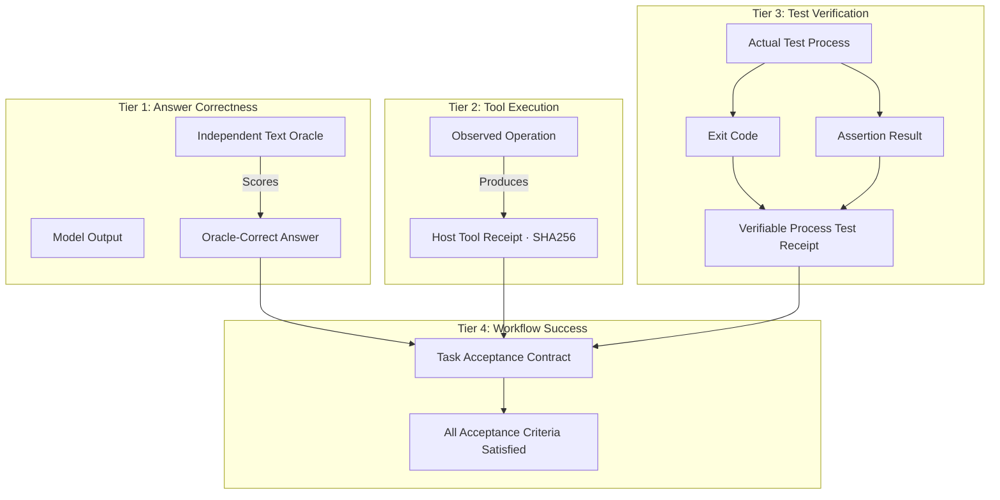

# MA4-S3-T4R1 Receipt and Provenance Validation

**Product:** Bunny A by LOKAM  
**Milestone:** MA4-S3-T4R1  
**Integrity Rule:** Zero Fabricated or Approximate Execution Receipts  
**Standard:** Cryptographic SHA256 Evidence Provenance  

---

## 1. Remediation of Synthetic Receipts

A primary measurement defect identified in MA4-S3-T4 was the generation of placeholder receipt strings (such as `rcpt-${task.id}`) whenever an independent text oracle scored model output as correct, even when no process execution or test tool had executed.

In MA4-S3-T4R1, synthetic identifiers have been eliminated from all outcome records and database stores. A receipt hash is recorded if and only if a genuine process or tool execution occurred on the Windows Host.

---

## 2. Four-Tier Truth Model

MA4-S3-T4R1 establishes four strictly decoupled evidence tiers:



### Tier 1 — Answer Correctness
- Scored by an independent text validator (e.g. regular expression matching, substring inclusion, or structural schema parsing).
- Indicates that the model output satisfies textual intent.
- **Does NOT** imply a test process executed.
- Represented in `outcomeRecord.status` as `"success"` or `"failure"`.

### Tier 2 — Tool Execution
- Triggered when a registered non-GPU executor (such as `file.read`) actually runs.
- Yields a SHA256 digest of the input arguments and returned output content (`sha256(filePath + ":" + content)`).
- Recorded in the task journal as a genuine tool event.
- Stored in `outcomeRecord.hostVerified.stepReceipts`.

### Tier 3 — Test Verification
- Produced when an automated test or assertion executes through `local.test`.
- Records:
  - Process exit code (strictly `0` for passing assertions; non-zero for failures).
  - Standard output and standard error streams.
  - Cryptographic test receipt hash (`sha256(testReport)`).
- Stored in `outcomeRecord.testProcessReceipts`.
- Tasks evaluated purely via text oracles have `testProcessReceipts: []`.

### Tier 4 — Workflow Success
- The task transitions to `COMPLETED` if and only if:
  1. Every required step in `spec.acceptance.requiredSteps` succeeded with a verified receipt.
  2. The execution did not exceed the envelope budget.
  3. No security policy violation occurred.

---

## 3. Provenance Verification Algorithm

Every artifact stored in the adaptive planner's cache or cited in a handoff message undergoes cryptographic verification:

```typescript
export function verifyReceiptProvenance(receipt: string, facts: {
  kind: string;
  sourceHash: string;
  bytes: number;
}): boolean {
  if (!/^[0-9a-f]{64}$/.test(receipt)) return false;
  const expectedHash = sha256(`${facts.kind}:${facts.sourceHash}:${facts.bytes}`);
  return receipt === expectedHash;
}
```

A receipt without matching Host journal facts is rejected as untrusted, preventing replay attacks and phantom success claims.
