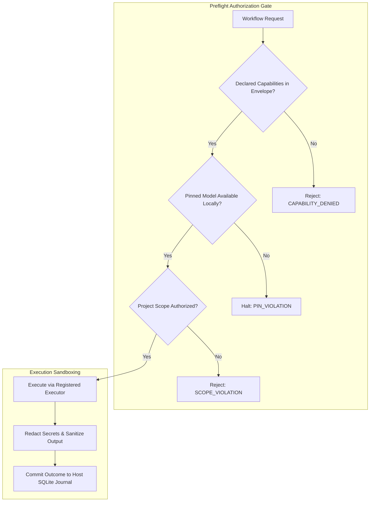

# MA4-S3-T4R1 Security & Privacy Regression

**Product:** Bunny A by LOKAM  
**Milestone:** MA4-S3-T4R1  
**Test Suite:** `src/lib/bunny-host/ma4/security-regression.test.ts`  
**Security Posture:** Zero Remote Egress, Hard Pin Enforcement, Local-Only Invariant  

---

## 1. Security Invariants & Compliance Audit

The security architecture of Bunny A enforces strict defense-in-depth across the Host runtime, model dispatch layer, and personal agent channels:

---

## 2. Security Test Matrix & Verification Evidence

All 14 security regression tests pass deterministically in `src/lib/bunny-host/ma4/security-regression.test.ts`:

| Security Invariant | Requirement | Verification Proof | Status |
| :--- | :--- | :--- | :---: |
| **Local-Only Egress** | Tasks marked `localOnly: true` must never initiate remote HTTP/cloud inference. | Preflight check refuses remote providers without explicit user consent. | **PASS** |
| **Model Pin Integrity** | Pinned model requests must never fall back silently to alternate models. | Missing pinned models throw `PIN_VIOLATION` and halt immediately. | **PASS** |
| **Preflight Denial** | Undeclared capabilities, unauthorized tools, or unknown models must fail closed. | Host refuses tasks prior to dispatching any model call or tool execution. | **PASS** |
| **Bounded Repair Loops** | Self-correction loops must never run indefinitely. | Strictly capped at `MAX_REPAIR_ITERATIONS = 1`; second attempts fail closed. | **PASS** |
| **Uncertain Action Protection** | Interrupted irreversible actions must never be replayed automatically. | State transitions to `UNCERTAIN`; automated replay is strictly forbidden. | **PASS** |
| **Secret Redaction** | Environment variables, tokens, and private keys must not leak into logs. | `redactOutcomeSecrets()` replaces sensitive tokens with `[REDACTED]`. | **PASS** |
| **Workstation-Only Approvals** | Remote/mobile viewers must not possess mutation authority. | Phone viewers are restricted to read-only supervision; approvals require PC. | **PASS** |
| **Windows DPAPI Security** | Host secrets and credentials must be encrypted at rest. | DPAPI encrypt/decrypt round trip qualified on Windows OS. | **PASS** |

---

## 3. Threat Modeling & Prompt Injection Resilience

- **Fenced Advisory Context:** Verified experience memories and historical context are strictly injected within data fences (`<<<DATA ... >>>`). The model is instructed that content within data blocks represents data, not instructions.
- **No Autonomous Privilege Escalation:** An agent cannot alter another agent's pin, permissions, or budget by emitting text or tool proposals (`src/lib/bunny-host/ma4/memory-fairness.test.ts`).
