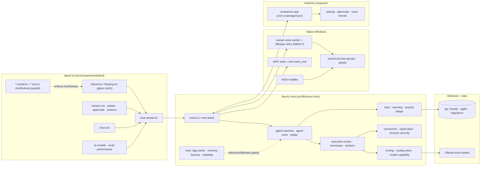

# BUNNY A — PRODUCT MASTERPLAN

**Product:** Bunny A by LOKAM
**Repository:** `COMRADEART/bunny-A` (local mirror `bun-router`)
**Document created:** 2026-10-31
**Baseline:** main = `f29ab04` (Merge PR #66, MA5-S2 Phase 4R1), draft PR #67 open (S3R1)
**Purpose:** Single source of truth for what Bunny A already is, what is proposed, what is
missing, and what is blocked — with the first sprint contract. Every status below cites
repository evidence; nothing is asserted from memory or desire.

---

## 1. Authoritative baseline

### 1.1 Git state (verified 2026-10-31)

| Item | Value | Evidence |
|---|---|---|
| main HEAD | `f29ab04` — Merge PR #66 (MA5-S2 Phase 4R1 voice qualification) | `git log bunny-a/main` |
| Latest merged milestone PR | #66 — whisper shim pin `45f64172` adopted (owner-authorized), hard acoustic-session deadline, verified playback volume, UIA notch-tree JSON fix, 4R1 correction + regression evidence | main history `99b1930..6e4b553` |
| Latest draft PR | **#67 — OPEN/DRAFT**, head `ma5-s2-p4-attended-latency-fix`, base `main`, updated 2026-10-30: attended-harness fixes (hands-free start answered end-to-end, no stop mid-reply, interrupt re-arms only after aborted capture released the device, zero on-disk transcripts, survives abnormal termination) + A18 criteria + resumed-S3 matrix | `gh pr view 67` |
| Security lines | `sec/resolve-better-auth-advisory` (better-auth → 1.7.14, GHSA-q84f-53jg-9ppm; local HEAD `68951b5`), `sec/seroval-1.7.3` | **MERGED** into main (PR #54 2026-10-27; PR #62 2026-10-29) - see 1.2 update note
| MA4-S2 beta verdict | **CONDITIONAL GO** (2026-10-24): 6/10 gates unconditional PASS (CI, typecheck, UIA, local-model quality, Narrator, security: 0 npm-audit vulns / 478 deps); soaks Soak A 19.2 h + Soak B 0 crashes; 3 gates conditional on signing certs / Android hardware / soak duration; 0 code defects | `docs/ma4-s2-final-fix/MASTER_GATE_TABLE.md`, `BETA_GO_NO_GO_FINAL.md` |
| Physical gates | **BLOCKED**, no authorized physical session run (see §5 Track A/J) | `docs/ma4-s3-t5/T5R1_PHYSICAL_GATE_STATUS.md` |

### 1.2 Working-tree and worktree map (current machine)

| Path | Branch/HEAD | Notes |
|---|---|---|
| `bun-router` (root) | `sec/resolve-better-auth-advisory` @ `68951b5` | **Dirty:** `src/lib/bunny-host/voice/voice-session.server.ts` (small edit), `startup.sh`; untracked `scripts/ma5-s1r1-installer.test.mjs`, `android/app/src/main/java/com/routeragent/jev/NativeCompanionActivity.java`, `.claude-flow/` — ownership not confirmed, preserved untouched |
| `bun-router-ma5s2` | detached at main `f29ab04` | existing integration worktree |
| `bun-router-p4fix` | `ma5-s2-p4-attended-latency-fix` @ `f3e7ca9` (S3R1 / PR #67 head) | active voice-harness line |
| `bun-router-sec-seroval` | `sec/seroval-1.7.3` @ `0e49c7b` | security remediation |
| `bun-sec-main` | `agent/bunny-a/sec-mainline-deps` @ `bc0fbf0` | **locked** — do not use |
| `bun-router-masterplan` | `docs/bunny-a-masterplan` @ main | this document's worktree |

> **2026-10-31 update (security-lane reconciliation):** the two security-lane branches above
> were merged into main before the master program's Sprint 1 - PR #54 (better-auth -> 1.7.14,
> GHSA-q84f-53jg-9ppm, merge commit `eeaac56`, 2026-10-27) and PR #62 (seroval ->
> 1.7.3, merge commit `4fd7975`, 2026-10-29). The worktrees remain only as archived
> checkouts. The only remaining `npm audit` finding on the current baseline is the
> dev-toolchain eslint/minimatch chain (GHSA-g3hv-75wg-m249, moderate, dev-only; the CI security
> gate runs production-only at high+ and passes), queued as lane
> `sec/minimatch-toolchain-override`.
>
> **2026-11-01 update (post security cycle, verified live):** main = `8685c59`. Merged since
> the snapshot above: PR #69 (M2 Sprint 1 - Native UX slice, island truthfulness locks),
> PR #70 (lint hygiene: errors 58 -> 0, warnings 127 -> 20), PR #71 (M2 Sprint 2 - native
> notch persistence, receipts 132/132), PR #72 (`sec/minimatch-toolchain-override` merged -
> full `npm audit` now reports **0 findings** of any severity), PR #73 (the lane-status
> correction above). The `1.1` table rows and the `MA5 S2` row in `1.3` predate these
> events; current status lives here, in the Track tables, and in `Section 5` below.

### 1.3 Milestone history (implemented, evidence-traced)

| Milestone | Scope delivered | Key evidence |
|---|---|---|
| MA0 (+R) | Mission architecture, state machine, security model, capability model | `docs/MA0_MISSION_STATE_MACHINE.md`, `MA0_SECURITY_MODEL.md`, MA0 review packets |
| MA1 | Live acceptance of routing/product v1 | `MA1_ACCEPTANCE_REPORT.md`, matrix |
| MA2 (+1D) | Operational hardening: failure injection T3, dashboard T5, remote T6, Windows sign-in T7, rollback T8, approval batching T9(+R), adversarial audit T10, process ownership, migration | `MA2_T*.md`, `docs/ma4-s2-final-fix/` |
| MA3 | T1 model capability · T4 persistent agent · T5 agentic authorization · T6 cross-app · T7 project workspace · T8 premium UI · T9 phone remote (+F01–F04 closures) · T10 live voice · T11 multi-agent long-run · T12 full-duplex voice · T13×3 integrated product (Laya/JEV, accounts, premium UX, lotus memory contract, harness matrix) · T14 autonomy | `MA3_T*.md`, `docs/t13-3/`, `docs/t14/` |
| MA4 S1 (+1R–4R) | Model intelligence: local model inventory/tournament, hybrid + live qualification, routing benchmarks, dependency audit, agent reliability, tool augmentation, repair engine, sandbox validation | `docs/ma4-s1*` |
| MA4 S2 (+final gates) | Persistent runtime · connected actions · proactive companion (+product qualification) · release packaging (NSIS installer, signing/provenance docs, update+rollback) · native experience (onboarding, notch/voice UX, notifications, accessibility, device mgmt) · provider integrations (OAuth+scopes, connector registry, browser security, calendar/email/documents) · ops reliability (privacy/telemetry, diagnostics, soak, crash recovery, beta feedback) · release candidate | `docs/ma4-s2*` |
| MA4 S2 final | Master gates 10/10 pass-or-conditional; beta **CONDITIONAL GO** | `MASTER_GATE_TABLE.md` |
| MA4 S3 | Unified foundation (+wiring) · adaptive intelligence (+qualification, production closure) · realtime voice (+R1 live qualification) · unified agent execution (+R1 real-agent qualification, +R2 security boundary closure) · agent reliability optimization (+R1 real-workflow qualification, +R2 measurement integrity) · integrated consumer experience, Windows–Android qualification, beta preflight (**merged as PR #51**) | `docs/ma4-s3-t5/`, branch `ma4-s3-t5-...` |
| MA4 S2R1 | Memory relevance | branch `ma4-s2r1-memory-relevance` |
| MA5 S1 | Native application productization | branch `ma5-s1-native-application-productization`; untracked installer test pending ownership |
| MA5 S2 | Native agents + voice: phase 2 glass notch, phase 3 realtime voice, phase 4 voice qualification → PR #65/#66 (Phase 4R1); S3 owner-attended qualification started (S1 recognition done; S3 paused) → PR #67 draft | branch tree `ma5-s2-*`; main history |
| MA5 S2 Sprint 1 (PR #69) | Native UX slice: Mission Control view truthfulness regression locks + acceptance report | commit `dce827c` |
| MA5 S2 hygiene (PR #70) | Lint debt: errors 58 -> 0, warnings 127 -> 20 | commit `85855f9` |
| MA5 S2 Sprint 2 (PR #71) | Native notch persistence: dock + cold-restart receipts 132/132 + restore-rules unit locks | commit `425ffb1` |
| MA5 S2 security+docs cycle (PRs #72/#73; earlier lane PRs #54/#62 verified) | Dev-toolchain advisories cleared - full `npm audit` 0 findings of any severity; stale lane records corrected | commits `2611b5a`, `8685c59` |

### 1.4 Stack facts that constrain the plan

- Web island + Host: React 19, TanStack Start/Router/Query, Tailwind v4, zustand; server functions over Nitro; better-auth 1.7.14; pg/Kysely (+pglite for local); Node test runner with a very large `src/lib/bunny-host/*.test.ts` suite; Playwright smoke.
- Native Windows: WPF shell + UIA (`notch_tree`), owned-process group, `[BunnyWin]::OnInputDesktop()` fail-closed gate, DPAPI credentials, NSIS installer scripts, owned voice worker + Whisper shim (pin `45f64172`).
- Local inference: Ollama adapters; qualified `qwen2.5-coder:7b` (DEV 5/5, HELDOUT 4/5, HELDOUT_V2 5/5) and `deepseek-r1:7b` calibrated (`think: false`); cloud LLM fallback **permanently disabled** at MA4-S2.
- Android: native companion app (`android/`, package `com.routeragent.jev`), release APK built hermetically; pairing/remote surfaces from MA3-T9 + MA4-S3-T5.

---

## 2. Perfection definition (what "perfect" must mean here)

"Make it a perfect product" translates into five measurable obligations:

1. **Truthfulness of state** — the island shows only real Host events; zero fabricated progress, agents, or approvals; mocks only when visibly labeled (already codified; keep enforced by tests).
2. **Latency budget** — actual speech→answer under load targets 3 s; Phase 4R1 evidence reports ≈ 6.5 s P50 under load (owner-provided session note). Closing this gap is the #1 product-feel defect.
3. **Calm, native UI** — glass island that is legible, edge-assignable, draggable, reduced-motion-safe, and Narrator-complete.
4. **Permissioned autonomy** — every sensitive action gated on a *real human* approval; cloud defaults off; model/credential pins inviolable.
5. **Evidence-per-increment** — every PR ships a scoped acceptance verdict (PASS/PARTIAL/FAIL/BLOCKED); no historical evidence reused as fresh.

Everything in §4–§6 serves exactly one of these obligations.

## 3. Architecture dependency map (current, as built)

Reading rules for future work:
- UI truthfulness flows **only** from `host-stream.ts` → `*-model.ts` → view; models are the only place allowed to sanitize/maps Host events.
- Anything new (Track C/G/H features) plugs in via existing Host seams (`EX`, `SE`, `LO`) — no parallel engine.
- The Android line talks to the Host only through the established pairing/gateway contracts (MA3-T9 + F04 containment).

---

## 3. Capability inventory (Tracks A–J)

Statuses: **IMPLEMENTED** (evidence in main/merged PR), **PARTIAL** (some accepted evidence, gaps open), **MISSING**, **BLOCKED** (needs owner/credentials/hardware).

### Track A — Real-time voice

| Capability | Status | Evidence / anchor |
|---|---|---|
| Full-duplex capture/playback, turn-boundary handling | IMPLEMENTED (MA3-T12) | `MA3_T12_FULL_DUPLEX_VOICE_ACCEPTANCE.md` |
| Live attended qualification harness | IMPLEMENTED | branches `ma4-s2-t2-realtime-voice`, `ma4-s2-t2r1-live-voice-qualification` |
| Whisper pin adoption + fingerprint verification | IMPLEMENTED (PR #66, owner-authorized) | `6e4b553`, `1b057ea` |
| Hard acoustic-session deadline, playback-volume verification, private evidence | IMPLEMENTED (PR #66) | `8002944` |
| Hands-free interruption after aborted capture (device re-arm) | PARTIAL → PR #67 review | `c6a8e1a` |
| Attended harness: whole-answer latency, no stop mid-reply | PARTIAL → PR #67 review | `f8dff3b`, `3eb2c94` |
| Zero-transcript-on-disk, abnormal-termination survival | PARTIAL → PR #67 review | `b964c67` |
| A16–A20 physical acoustic qualification (AEC, real-room barge-in, reconnect) | **BLOCKED** — owner-attended sessions only | `T5R1_PHYSICAL_GATE_STATUS.md` |
| Under-load answer latency 3 s target | PARTIAL — ≈6.5 s P50 under load reported at 4R1; S3 paused pending A18 | owner session note (2026-10) |
| A18 prospective criteria (WER ≤15% missing-as-deletion, no-result ≤5%, 0 unauthorized, ≥48 utterances / ≥200 ref words) | RATIFIED in repo, unmeasured | `f3e7ca9` (PR #67 docs) |
| Local multilingual recognition, wake-word (OFF by default) | MISSING | planned M4 |
| Voice commands for Mission status / safe interactions | MISSING | planned later M2 sprint (sprint 2 was notch persistence) |

### Track B — Native UI/UX

| Capability | Status | Evidence / anchor |
|---|---|---|
| Floating glass notch island (compact/expanded/focus) | IMPLEMENTED | `src/components/island/*` (island.tsx, floating.tsx, glass.css), `docs/ma4-s2-t5/NOTCH_VOICE_UX.md` |
| Edge placement + drag + persistent position (all edges) | IMPLEMENTED (agent-side) — PR #69 web edge locks; PR #71 native drag/keyboard/cold-restart receipts 132/132 | owner Round 4 (physical hand) is the remaining confirmation |
| Voice visualization states + truthful mic state | PARTIAL — designed; device-disconnected + muted truthfulness checks to test | `NOTCH_VOICE_UX.md`, UIA `notch_tree` fix `d396f65` |
| Agent compact identities (Gada/Spear/Chakra/Sword + provider marks) | PARTIAL — character system exists, animated-from-events contract pending verification | `src/components/island/characters.tsx`, `character-styles.css`, `docs/t13-3/CHARACTER_STYLE_SYSTEM.md` |
| Mission Control product panel | IMPLEMENTED in island code | `mission.tsx`+`mission-model.ts`(+test), `ptasks.tsx`, `approvals.tsx`, `activity.tsx`, `workers.tsx` |
| Truthful-state runtime guarantee (no fabricated retry/agents) | PARTIAL via unit tests (`island-states.test.ts` etc.); needs live end-to-end evidence | `npm run test:ui` |
| Personalization (themes/glass/accent/motion/density) | IMPLEMENTED (themes catalogue + tokens + widget theme integration) | `docs/visual-experience-2/THEME_*.md`, `ui-theme*.test.ts` |
| Windows accessibility full qualification (Narrator live rounds, DPI) | PARTIAL: AXTree 11/11 live PASS at MA4-S2; complete multi-DPI/NC re-qualification BLOCKED | `MASTER_GATE_TABLE.md` GATE-S2-A11Y-WIN; `T5R1_PHYSICAL_GATE_STATUS.md` |
| Android TalkBack on physical hardware | **BLOCKED** (USB test device) | `BETA_GO_NO_GO_FINAL.md` BLK-S2-03 |

### Track C — Agent Mission Control / orchestration

| Capability | Status | Evidence / anchor |
|---|---|---|
| Mission engine, agent machine, permissions, idempotency, ownership | IMPLEMENTED | `src/lib/bunny-host/agent-machine.test.ts`, `agent-store`, `ma2-t10`, `stop-ownership` |
| Unit batching/approvals (duplicates closed) | IMPLEMENTED | `MA2_T9R_DUPLICATE_CALCULATOR_CLOSURE.md` |
| DAG execution, retries, checkpoints, failure containment | IMPLEMENTED | `docs/ma4-s2/TASK_PLANNING_DESIGN.md`, `MA2_T3_*`, `src/lib/bunny-host/ma4/dag-cache.test.ts` |
| Real-workflow qualification + measurement integrity | IMPLEMENTED (PRs #49/#50 merged) | `6653d09`, `9596c...`, `MA2_T6...` |
| Cross-app execution (UIA/X53) with fail-closed desktop gate | IMPLEMENTED | `cross-app-live.test.ts`, GATE-S2-UIA PASS |
| Cancellation ordering invariant | IMPLEMENTED | `cancellation-ordering.test.ts` 3/3 |
| Skill registry, versioning, sandboxed execution, promotion policy | IMPLEMENTED | `docs/ma4-s2/SKILL_REGISTRY.md`, `SKILL_PROMOTION_POLICY.md`, `SECURITY_VALIDATION.md` |
| Multi-agent long-run stability | IMPLEMENTED | `MA3_T11_MULTI_AGENT_LONG_RUN_ACCEPTANCE.md`, `ma4/multi-agent-reliability.test.ts` |
| Mission replay (read-only reconstruction + receipts) | PARTIAL | `agent-replay.test.ts` exists; owner-facing replay UX missing |
| Objective result-verification (C7) against task-specific criteria | PARTIAL | reviewer calibration exists (`deepseek` think:false); per-task acceptance criteria contract missing |
| Spoken phrases must never count as approvals | RATIFIED; regression test isolated to be verified in Sprint 1 checklist | plan §C4 |

### Track D — Model intelligence / resource management

| Capability | Status | Evidence / anchor |
|---|---|---|
| Local model routing + capability matrix+provenance | IMPLEMENTED | `model-capability.test.ts`, `routing*.test.ts`, `docs/ma4-s2/MODEL_ROUTING_EVIDENCE.md` |
| Model qualification evidence pipeline (DEV/HELDOUT/HELDOUT_V2 + refusals 24/24) | IMPLEMENTED | GATE-S2-QUAL PASS |
| Prompt-injection defenses (local) | IMPLEMENTED | same evidence |
| Cloud inference default-off + explicit approval design | IMPLEMENTED | `docs/ma4-s1r4/CLOUD_APPROVAL_REQUEST.md`; cloud fallback disabled |
| Pinned models + digest validation | IMPLEMENTED | `release-identity.test.ts`, whisper pin `45f64172` (owner-authorized flow = precedent) |
| Local Model Control Center UX (usage/pricing gates, task→model assignment) | PARTIAL | `src/components/island/local-performance.tsx`, `ai-models.tsx` exist; assignment explanations + budget UX incomplete |
| 6 GB VRAM co-scheduling guarantee (voice+agents) | PARTIAL — fairness module added (`ma4/memory-fairness.test.ts`) | bound by 6 GB reality; measurement ongoing in S3 |
| Hosted model selection with measured quality burn-in | MISSING (deliberately off pending owner policy) | M4 decision |

### Track E — Lotus memory

| Capability | Status | Evidence / anchor |
|---|---|---|
| Lotus store + Host integration + agent memory contract | IMPLEMENTED | `lotus.test.ts/lotus-host.test.ts`, `docs/ma4-s2/LOTUS_MEMORY_INTEGRATION.md`, `docs/t13-3/LOTUS_AGENT_MEMORY_CONTRACT.md` |
| Memory relevance ranking | IMPLEMENTED (S2R1) | branch `ma4-s2r1-memory-relevance` |
| Duplicate/contradiction + expiry policy surfaces in UX | PARTIAL | model logic v1; review/correction UI minimal |
| Adversarial poisoning / prompt-injection via docs regression | IMPLEMENTED (24/24 refusal, measured) | GATE-S2-QUAL |
| User-facing memory review, per-project isolation, deletion/export controls | PARTIAL→MISSING | M4 scope |

### Track F — Windows+Android continuity

| Capability | Status | Evidence / anchor |
|---|---|---|
| Android companion app (voice remote, approvals view, pairing contracts) | IMPLEMENTED (code + hermetic APK) | `MA3_T9_PHONE_REMOTE_ACCEPTANCE.md`, `MA3_T9R_F01..F04`, `MA3_T9R_F04_PROVIDER_PROCESS_CONTAINMENT.md` |
| Windows–Android integrated consumer qualification | IMPLEMENTED (PR #51 integration report; live device run BLOCKED) | `docs/ma4-s3-t5/`, beta preflight |
| Cross-device Mission approvals end-to-end on physical phone | **BLOCKED** (BLK-S2-03; pairing reconnection + revocation on device) | `T5R1_PHYSICAL_GATE_STATUS.md` |
| Staleness labeling / displacement offline queue / duplicate-approval protection | PARTIAL (models exist: `companion-model`, `remote-view-model` + tests; device-session validation pending) | M3 scope |
| Android 17/API 37 adaptation suite | MISSING | M3 scope — owner decision on supported versions first |

### Track G — Visual/contextual assistance

| Capability | Status | Evidence / anchor |
|---|---|---|
| Window-aware assistance with explicit consent; smallest-scope capture | PARTIAL (context panel + desktop builders exist) | `desktop.tsx`, `context-panel.tsx`; MA3-T6 cross-app |
| Screenshot explanation / document extraction / UI discovery | PARTIAL | connectors restricted per `browser-security`; visual QA pipeline M5 |
| Confirmation-before-action computer interaction | IMPLEMENTED (approval batching + fail-closed broker) | `MA2_T9_*`, T6 broker |

### Track H — Connected services / automations

| Capability | Status | Evidence / anchor |
|---|---|---|
| Connector registry (email/calendar/documents/browser) + OAuth+scopes | IMPLEMENTED | `docs/ma4-s2-t6/*.md`, `oauth-pkce.test.ts`, connector broker fail-closed ×9 |
| Scheduled tasks with explicit opt-in + notifications | IMPLEMENTED | `docs/ma4-s2-t5/NATIVE_NOTIFICATIONS.md`, `MA2_T9*` |
| Scheduled + failure notifications UX | PARTIAL | needs production polish pass |

### Track I — Performance & polish

| Capability | Status | Evidence / anchor |
|---|---|---|
| 24 h soaks (A + B) with leak/crash zeros | IMPLEMENTED | BETA_GO_NO_GO table |
| Idle CPU/memory budgets per-window with gates | MISSING as formal budget table | add in M1 |
| Voice P95 latency budget measured per stage (STT/turn/TTS/TTFT) | PARTIAL measurement scaffolding in attended harness | S3 |
| Multi-DPI/multi-monitor island correctness | PARTIAL | one UIA fix merged (`d396f65`); full matrix pending |

### Track J — Security/privacy/product readiness

| Capability | Status | Evidence / anchor |
|---|---|---|
| 0 npm-audit vulnerabilities; DPAPI; credential containment; provider process containment | IMPLEMENTED | GATE-S2-SEC; `MA3_T9R_F04` |
| Windows NSIS: non-admin install/upgrade/uninstall | IMPLEMENTED (syntax+layouts verified; signing requires EV cert) | GATE-S2-PKG-WIN CONDITIONAL |
| Windows Authenticode EV signing + SmartScreen reputation | **BLOCKED** (operator credential) | BLK-S2-01 |
| Android keystore signing / Play upload | **BLOCKED** (release keystore) | BLK-S2-02 |
| Soak B (24 h) completion on record | VERIFY — adjudication listed it running with completion 2026-10-25; confirm recorded soak report exists before M6 | BLK-S2-04 |
| Interactive Windows input-desktop X53 (live Calculator automation on unlocked desktop) | BLOCKED — environment prerequisite, not code | BLK-S2-05 |
| Redacted crash diagnostics + retention control surfaces | IMPLEMENTED design + docs | `docs/ma4-s2-t7/PRIVACY_AND_TELEMETRY.md`, `CRASH_RECOVERY.md`, `OPERATIONAL_DIAGNOSTICS.md` |
| Reproducible release builds (pinned toolchains) | PARTIAL | add reproducible-build gate before M6 |

## 4. Prioritized defects and improvements

Ranked by product impact to "it actually feels like a perfect product":

| # | Item | Track | Why first | Evidence gap |
|---|---|---|---|---|
| 1 | Land S3R1 (PR #67) → measure whole-answer latency + A18 WER at attended session; target <6.5s→3s P50 | A | It blocks every "natural conversation" perception | S3 paused; needs owner session |
| 2 | Sprint 1: Mission Control/Native UX vertical slice with real Host data + truthfulness tests — contract in `docs/roadmap/SPRINT_1_NATIVE_UX_SLICE.md` | B/C | Largest user-visible value; zero risk to the voice line | new |
| 3 | Island edge placement & persistence (top/bottom/left/right, DPI, taskbar safety) | B | Every boot will feel broken if wrong placement persists | not yet evidenced |
| 4 | Merge security branches (better-auth 1.7.14, seroval) after CI | J | Two known advisories otherwise live in product | branches exist |
| 5 | Owner-decision pass: uncommitted voice edits + untracked native files | Ops | They can silently diverge from S3R1 | unknown ownership |
| 6 | Mission replay UX (read-only event+receipt timeline) | C | Trust multiplier; cheap once engine knows it | engine partially ready |
| 7 | Spoken-phrase approval exclusion regression | C/J | Hard rule §17; must be *test-locked* not doc-locked | not yet isolated |
| 8 | Narrator/TalkBack re-qualification after S3/T5 voice-UX merges | B/J | Accessibility regressions are silent failures; re-run checklists after each UX merge | state drift in UX files |
| 9 | Soak B completion watch + Soak C (voice + agents concurrent) | I | Long-session truthfulness under new voice line | BLK-S2-04 related |
| 10 | MV-recovery: result-verification contract (C7) with per-task acceptance criteria | C | "Quality verification" roadmap anchor | design doc needed |

## 5. Execution plan mapped to owner milestones

- **M1 — Phase 4 closure + outcome (S3)**: PR #67 merged (`0628dc1`, 2026-10-31). Remaining: owner-attended A18/A19 acoustic session for physical qualification (must be *fresh* device-specific authorization; refuse otherwise) — measure A16–A20, Narrator acceptance.
- **M2 — Native UX Mastery**: edge placement/persistence + notch truthfulness DONE (Sprints 1–2: PR #69 locks; PR #71 native drag/keyboard/restart receipts 132/132; PR #70 lint debt closed). NEXT: agent-visual truthfulness lock (Sprint 3, in flight as `ma5-s3-sprint1-agent-visuals`) + re-run `test:ui`, browser smoke, UIA notch tree.
- **M3 — Android continuity**: physical pairing/approval sessions (owner hardware) + staleness/offline duplicate-approval protections as implemented models check out live.
- **M4 — Agent intelligence & memory**: replay UX + result verification + model-budget UX + multi-model routing explanations.
- **M5 — Contextual assistance & skills**: visual/skills expansions behind existing connector-broker and `APPROVAL` gates.
- **M6 — Beta qualification**: signing (owner creds), store readiness, reproducibility gate, security re-audit, final go/no-go table refresh.

Order rule: no milestone blocks a *safe, unrelated* software increment; physical/software gates only as listed.

## 6. Owner decisions required (BLOCKED until decided)

1. **Acoustic session S3** (date, device, duration, output ceiling) — can only be operator-confirmed.
2. **Windows EV cert + Android keystore provisioning** — cannot be bypassed for release.
3. **Physical Android device availability** for BLK-S2-03 + TalkBack ×physical.
4. **Ownership of working-tree edits** (voice-session.server.ts, startup.sh, NativeCompanionActivity.java, ma5-s1r1 test) — commit/fold/discard decision belongs to their author.
5. **Beta posture**: current formal verdict is CONDITIONAL GO (MA4-S2); keep it, or revert to NO-GO framing pending M6? (This document does not retract gate verdicts; it reports them.)
6. **Cloud model policy**: currently strictly local-first with one-time approval pathway; confirm long-term tiering.

## 7. What this document does NOT do

- It does not replace gate tables with new claims; it *cites* them.
- It does not authorize any physical session, signing act, store upload, or merge.
- It does not promise performance numbers never measured here.
